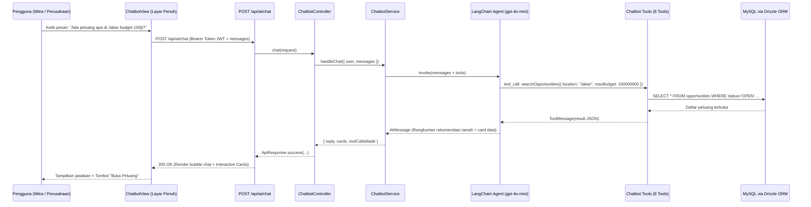

# 🤖 AI Service: SIPENA AI CSR Advisor (Conversational Agent with LangChain Tools)

Dokumentasi arsitektur, spesifikasi teknis, skema function tools, integrasi prompt engineering, dan REST API untuk modul **SIPENA AI Advisor (Chatbot Co-Pilot)** dalam platform **SIPENA (Project CSR)**.

Fitur ini menyediakan asisten percakapan cerdas layar penuh (*full-screen chat*) yang dapat digunakan oleh **Mitra (NGO / Yayasan)** maupun **Perusahaan (Company / CSR Admin)** untuk melakukan *brainstorming* inisiatif CSR, pencarian rekomendasi peluang berbasis database, pemantauan status proposal & revisi, serta konsultasi standar keberlanjutan **POJK 51 & UN SDGs**.

---

## 1. Latar Belakang & Masalah Bisnis

### Problem Statement
1. **Peluang CSR Sulit Dicocokkan Secara Cepat**: Mitra seringkali harus membaca dokumen TOR satu per satu secara manual untuk mengetahui apakah kapasitas dan fokus isu mereka cocok dengan kriteria perusahaan.
2. **Keterbatasan Kapasitas Mitra dalam Menyusun Proposal Berkualitas**: Banyak yayasan lokal memiliki niat dan kapabilitas lapangan yang hebat, namun kesulitan merumuskan indikator SMART, rincian 3 tahapan kerja, serta breakdown RAB yang akuntabel.
3. **Perusahaan Membutuhkan Bantuan Ideation CSR**: Tim CSR korporat sering membutuhkan inspirasi konsep inisiatif baru yang inovatif, berdampak terukur, dan selaras dengan regulasi OJK (POJK 51/POJK.03/2017) serta target SDGs.
4. **Data Monitoring Tercecer**: Pengguna harus berpindah-pindah menu untuk mengecek serapan anggaran, capaian penerima manfaat, atau catatan revisi proposal.

### Solusi Fitur AI CSR Advisor
1. **Agentic Tool Calling LangChain**: Chatbot dibekali 8 Function Tools berbasis Drizzle ORM yang mengakses data nyata di platform secara real-time.
2. **Dual-Role Persona Adaptation**:
   - **Bagi Mitra**: Persona *Proposal & Growth Co-Pilot* (rekomendasi peluang, brainstorming draf proposal, tips lolos AI screener, dan panduan perbaikan catatan revisi).
   - **Bagi Perusahaan**: Persona *Corporate CSR & ESG Strategy Advisor* (perumusan inisiatif baru, rekapitulasi portofolio, dan analisis serapan dana).
3. **Interactive Rich Action Cards**: Jawaban tidak hanya berupa teks polos, melainkan dilengkapi kartu interaktif (Kartu Peluang dengan tombol langsung ke detail peluang, kartu status proposal, dsb).
4. **Zero-Crash Resilient Fallback**: Bila API Key OpenAI tidak terpasang atau kuota habis, fallback engine lokal tetap mengeksekusi tools database dan menjawab dengan panduan terstruktur.

---

## 2. Struktur Modul

```text
src/
├── modules/
│   └── ai/
│       ├── services/
│       │   └── chatbot/
│       │       ├── chatbot.schema.ts       # Zod schemas untuk payload chat & 8 function tools
│       │       ├── chatbot.prompt.ts       # Generator System Prompt dinamis (Mitra vs Perusahaan)
│       │       ├── chatbot.tools.ts        # 8 LangChain Tools terhubung langsung ke Drizzle ORM
│       │       ├── chatbot.service.ts      # Agentic tool-calling loop (gpt-4o-mini) + Fallback
│       │       ├── chatbot.controller.ts   # Controller JWT AuthGuard & standard response
│       │       └── index.ts                # Ekspor submodule
│       └── index.ts                        # Singleton chatbotService & chatbotController
app/
└── api/
    └── ai/
        └── chat/
            └── route.ts                    # REST API Endpoint: POST /api/ai/chat
src/
└── components/
    └── dashboard/
        ├── chat/
        │   └── ChatbotView.tsx             # Full-screen conversational UI dengan smart prompt starters & rich cards
        ├── Sidebar.tsx                     # Menu navigasi "AI CSR Advisor" di sidebar Perusahaan
        └── partner/
            ├── PartnerSidebar.tsx          # Menu navigasi "AI CSR Advisor" di sidebar Mitra
            └── types.ts                    # PartnerNavMenu type extension
```

---

## 3. Rincian 8 Function Tools (LangChain + Drizzle ORM)

| No | Nama Tool | Input Schema | Sumber Tabel DB | Deskripsi & Kegunaan |
| :---: | :--- | :--- | :--- | :--- |
| **1** | `searchOpportunities` | `{ focusArea?, location?, minBudget?, maxBudget?, keyword? }` | `opportunities`, `companies` | Mencari peluang CSR yang berstatus `OPEN` dengan filter multi-kriteria. |
| **2** | `getOpportunityDetail` | `{ opportunityId: string }` | `opportunities`, `companies` | Mengambil detail lengkap TOR, anggaran, batas waktu, dan profil perusahaan sponsor. |
| **3** | `getMyProposals` | `{ status?: ProposalStatus }` | `proposals`, `opportunities`, `companies`, `partners` | Mengambil proposal terdaftar pengguna beserta status evaluasi dan catatan feedback reviewer. |
| **4** | `getProposalDetail` | `{ proposalId: string }` | `proposals`, `opportunities` | Mengambil rincian proposal, catatan revisi, dan evaluasi kelemahan dari AI Screener. |
| **5** | `getMyProgramsOverview` | `{ status?: ProgramStatus }` | `programs`, `companies`, `partners` | Rekap eksekutif program CSR: pagu anggaran, serapan dana (`spentBudget`), dan capaian penerima manfaat. |
| **6** | `getProgramMilestonesProgress` | `{ programId: string }` | `programs`, `program_stages`, `program_activities` | Rincian tahapan (*stages*) dan log kegiatan lapangan terbaru dari program tertentu. |
| **7** | `getMyOrganizationProfile` | `{}` | `partners` / `companies` | Membaca profil organisasi pengguna saat ini untuk personalisasi konteks percakapan. |
| **8** | `getCsrSdgsBenchmark` | `{ topic?: string }` | Knowledge base | Panduan 17 UN SDGs, 7 Fokus Area CSR SIPENA, dan metrik dampak terukur standar POJK 51. |

---

## 4. Diagram Alur Kerja (Agentic Tool Calling Pipeline)



---

## 5. Dokumentasi REST API

### `POST /api/ai/chat`
Mengirimkan percakapan interaktif ke asisten AI SIPENA.

#### Headers:
- `Content-Type`: `application/json`
- `Authorization`: `Bearer <jwt_token>`

#### Request Body:
```json
{
  "messages": [
    {
      "role": "user",
      "content": "Rekomendasikan peluang CSR yang sedang buka di bidang lingkungan"
    }
  ],
  "context": {
    "currentPage": "dashboard/chat"
  }
}
```

#### Response (200 OK):
```json
{
  "success": true,
  "statusCode": 200,
  "message": "Respon asisten AI berhasil dibuat",
  "data": {
    "reply": "Halo! Berdasarkan data terbaru di platform SIPENA, berikut adalah peluang CSR aktif bidang lingkungan...",
    "cards": [
      {
        "type": "OPPORTUNITIES",
        "items": [
          {
            "id": "35ee5752-7409-4a8d-925d-c228b9c3a5cb",
            "title": "Konservasi Mangrove Pesisir Utara",
            "companyName": "PT Telkom Indonesia",
            "focusArea": "LINGKUNGAN",
            "estimatedBudget": "150000000.00",
            "targetCity": "Indramayu",
            "targetProvince": "Jawa Barat",
            "deadline": "2026-12-31"
          }
        ]
      }
    ],
    "toolCallsMade": ["searchOpportunities"],
    "suggestedPrompts": [
      "Bantu saya brainstorming draf proposal bidang lingkungan",
      "Bagaimana status pengajuan proposal saya?",
      "Tips agar proposal lolos screening AI dengan skor tinggi"
    ]
  }
}
```

---

## 6. Contoh Pertanyaan yang Dapat Diajukan Berdasarkan Peran (Role)

Pengguna dapat berinteraksi dengan SIPENA AI Advisor menggunakan bahasa santai maupun formal. Berikut adalah panduan skenario dan contoh pertanyaan yang telah didukung oleh sistem dan function tools:

### 🤝 A. Untuk Mitra Pelaksana (NGO / Yayasan / Komunitas)

| Skenario Penggunaan | Contoh Pertanyaan Pengguna | Tool yang Dijalankan AI |
| :--- | :--- | :--- |
| **Pencarian Peluang CSR Terbuka** | *"Halo, ada peluang CSR apa saja yang sedang buka di wilayah Jawa Barat dengan fokus lingkungan?"* | `searchOpportunities` |
| **Filter Peluang Berdasarkan Pagu** | *"Carikan program CSR terbuka di bidang pendidikan dengan estimasi anggaran di atas Rp 75 juta."* | `searchOpportunities` |
| **Bedah TOR & Kriteria Peluang** | *"Saya tertarik dengan peluang 'Program Pemberdayaan UMKM Kopi'. Tolong jelaskan kriteria mitra yang dicari perusahaan tersebut."* | `getOpportunityDetail` |
| **Brainstorming Ide Judul & Latar Belakang** | *"Bantu lembaga kami membuat draf judul dan perumusan latar belakang proposal penanganan stunting di desa pesisir."* | Knowledge + `getCsrSdgsBenchmark` |
| **Perumusan Rencana Kerja 3 Tahapan** | *"Bagaimana pembagian milestone yang ideal untuk program rehabilitasi mangrove selama 6 bulan?"* | Knowledge + `getCsrSdgsBenchmark` |
| **Breakdown Rencana Anggaran Biaya (RAB)** | *"Bantu kami susun alokasi persentase RAB yang masuk akal antara belanja operasional, perlengkapan fisik, dan evaluasi dampak."* | Knowledge Base |
| **Cek Status Proposal Saya** | *"Bagaimana status proposal yang sudah kami ajukan ke PT Telekomunikasi? Apakah sudah direview?"* | `getMyProposals` |
| **Konsultasi Catatan Revisi Perusahaan** | *"Proposal kami ditandai 'REVISION_REQUESTED' dengan catatan 'mohon perjelas sasaran penerima manfaat'. Tolong bantu perbaiki narasinya."* | `getProposalDetail` |
| **Tips Lolos AI Screening** | *"Indikator apa saja yang dinilai oleh AI Screening SIPENA agar proposal kami mendapat skor di atas 85?"* | Knowledge Base |
| **Monitoring Milestone Program Berjalan** | *"Bagaimana progres tahapan aktivitas pada program 'Air Bersih Desa Sukamaju' yang sedang kami jalankan?"* | `getProgramMilestonesProgress` |

---

### 🏢 B. Untuk Perusahaan (Company / CSR Admin / Manajemen)

| Skenario Penggunaan | Contoh Pertanyaan Pengguna | Tool yang Dijalankan AI |
| :--- | :--- | :--- |
| **Monitoring Serapan Anggaran Portofolio** | *"Berapa total anggaran CSR yang sudah terserap dari seluruh program kita yang berstatus IN_PROGRESS bulan ini?"* | `getMyProgramsOverview` |
| **Evaluasi Capaian Penerima Manfaat** | *"Tolong rekap perbandingan antara target dan realisasi penerima manfaat dari program-program kita yang sedang aktif."* | `getMyProgramsOverview` |
| **Pemeriksaan Proposal Masuk** | *"Ada berapa proposal mitra yang saat ini masih berstatus UNDER_REVIEW dan belum kita putuskan?"* | `getMyProposals` |
| **Analisis Kelayakan Proposal Tertentu** | *"Tolong bedah rincian proposal dari Yayasan Bina Insan. Apakah estimasi durasi dan target penerima manfaatnya realistis?"* | `getProposalDetail` |
| **Brainstorming Inisiatif Baru Selaras SDGs** | *"Perusahaan kami bergerak di bidang logistik. Berikan 3 konsep inisiatif CSR baru tahun 2027 yang selaras dengan SDG 13 (Aksi Iklim) dan SDG 8 (Pekerjaan Layak)."* | `getCsrSdgsBenchmark` |
| **Kepatuhan Regulasi POJK 51 / OJK** | *"Apa saja indikator wajib yang perlu kami sertakan dalam Laporan Keberlanjutan tahunan untuk pilar perlindungan lingkungan?"* | `getCsrSdgsBenchmark` |
| **Deteksi Kendala di Lapangan** | *"Apakah ada milestone aktivitas yang tertunda pada pelaksanaan program di wilayah Jawa Timur?"* | `getProgramMilestonesProgress` |
| **Benchmarking Pasar CSR** | *"Program CSR apa saja yang sedang banyak dibuka oleh perusahaan lain di platform SIPENA pada sektor kesehatan?"* | `searchOpportunities` |
