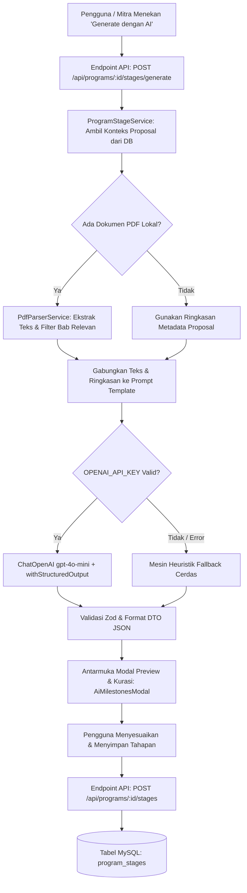

# AI Service: Proposal Milestone & Field Activity Extractor

Dokumentasi arsitektur, spesifikasi teknis, skema database, alur kerja prompt engineering, dan REST API untuk modul **AI Service** dalam sistem **CSR Impact Hub**.

Fitur ini bertugas mengekstrak rencana kerja, linimasa, metodologi, dan target dari proposal kemitraan CSR menggunakan Large Language Model (**OpenAI GPT-4o-mini**) melalui orkestrator **LangChain**, lalu mentransformasikannya menjadi **Tahapan Kegiatan Terstruktur (*Program Milestones*)** lengkap dengan panduan bukti dokumentasi lapangan.

---

## 1. Latar Belakang & Masalah

### Problem Statement
Sebelumnya, modul pelaporan kegiatan lapangan (*activity log*) bersifat tidak terstruktur:
1. Mitra pelaksana dapat mengunggah foto kegiatan apa saja tanpa ada acuan apakah kegiatan tersebut relevan dengan proposal yang disetujui.
2. Perusahaan kesulitan melacak sejauh mana tahapan pelaksanaan proyek telah diselesaikan.
3. Tidak ada panduan spesifik bagi personil di lapangan mengenai jenis bukti (*evidence*) apa saja yang wajib diambil (misal: foto berita acara, daftar hadir penerima manfaat, serah terima bibit).

### Solusi Fitur AI
Dengan memanfaatkan AI Service:
1. **Otomasi Dekonstruksi Proposal**: AI membaca isi proposal (ringkasan + isi dokumen PDF) dan memecahnya menjadi tahapan logis berurutan (misal: *Tahap 1: Sosialisasi*, *Tahap 2: Pengadaan*, *Tahap 3: Pelaksanaan Lapangan*, *Tahap 4: Serah Terima & Evaluasi*).
2. **Panduan Bukti Lapangan (*Expected Evidence*)**: Setiap tahap dilengkapi rekomendasi bukti foto/dokumen konkret yang harus dikumpulkan mitra.
3. **Indikator Keberhasilan (*Suggested KPI*)**: Setiap tahap memiliki target indikator untuk verifikasi perusahaan.
4. **Kurasi & Interaktivitas**: Hasil ekstraksi AI dapat ditinjau dan disesuaikan oleh pengguna sebelum disimpan permanen ke database program.

---

## 2. Arsitektur Modul AI (`src/modules/ai/`)

Modul AI dirancang modular dan terisolasi berdasarkan fungsi layanan (*domain services*) agar dapat diperluas untuk kasus penggunaan AI berikutnya (seperti *Impact Assessment AI*, *Financial Anomaly Detection*, atau *Automated Reporting*).

```text
src/modules/ai/
├── config/
│   └── openai.config.ts                     # Inisialisasi model OpenAI (ChatOpenAI gpt-4o-mini)
├── services/
│   ├── document-parser/
│   │   └── pdf-parser.service.ts            # Parser & ekstraktor teks dokumen PDF proposal
│   └── milestone-extraction/
│       ├── milestone-extractor.schema.ts    # Skema Zod untuk Structured Output LLM
│       ├── milestone-extractor.prompt.ts    # Prompt Template (System & Human Message)
│       └── milestone-extractor.service.ts   # Orkestrasi LangChain & Heuristic Fallback
├── ai.interface.ts                          # DTO tipe input & response modul AI
└── index.ts                                 # Central export hub
```

### Komponen Utama

| Komponen | File | Deskripsi |
| :--- | :--- | :--- |
| **Model Config** | `openai.config.ts` | Menginisialisasi `ChatOpenAI` dengan model `gpt-4o-mini`, `temperature: 0.2` (untuk konsistensi faktual), dan membaca `OPENAI_API_KEY` dari environment. |
| **Document Parser** | `pdf-parser.service.ts` | Mengekstrak teks dari berkas PDF lokal (`pdf-parse`), menyaring bagian relevan (jadwal, rencana aksi, metodologi), dan memotong teks agar aman dalam batas konteks token. |
| **Output Schema** | `milestone-extractor.schema.ts` | Definisi skema Zod ketat yang memaksa LLM mengembalikan format JSON valid (`summaryRationale`, `stages[]`). |
| **Prompt Template** | `milestone-extractor.prompt.ts` | Instruksi persona spesialis CSR dengan panduan penyusunan tahapan kronologis. |
| **Service Engine** | `milestone-extractor.service.ts` | Menggabungkan model dan prompt menggunakan `model.withStructuredOutput()`. Memiliki mesin *heuristic fallback* jika API offline. |

---

## 3. Diagram Alur Kerja (Extraction Pipeline)



---

## 4. Prompt Engineering & Skema Structured Output

### Prompt Template
- **Peran AI**: *"Senior CSR Project Manager & Monitoring-Evaluation (M&E) Specialist"*.
- **Instruksi**:
  1. Analisis ruang lingkup, bidang fokus, anggaran, dan durasi proyek CSR.
  2. Susun 3 hingga 6 tahapan kegiatan kronologis berurutan.
  3. Berikan rincian:
     - `title`: Judul tahapan yang lugas (contoh: *Tahap 1: Sosialisasi & Rembug Warga*).
     - `targetTimeline`: Estimasi waktu pelaksanaan (contoh: *Bulan ke-1*).
     - `description`: Uraian aktivitas kunci pada tahap tersebut.
     - `expectedEvidence`: Bukti foto atau dokumen wajib yang harus diunggah di lapangan.
     - `suggestedKpi`: Tolok ukur capaian tahap.
  4. Bahasa output wajib **Bahasa Indonesia** formal dan profesional.

### Skema Zod (Structured Output)
```typescript
export const milestoneExtractionSchema = z.object({
  summaryRationale: z.string().describe("Alasan dan ringkasan bagaimana tahapan disusun berdasarkan proposal"),
  stages: z.array(
    z.object({
      orderIndex: z.number().describe("Urutan tahapan (1, 2, 3...)"),
      title: z.string().describe("Judul tahapan kegiatan"),
      description: z.string().describe("Deskripsi rencana kerja pada tahap ini"),
      targetTimeline: z.string().describe("Linimasa target"),
      expectedEvidence: z.string().describe("Panduan foto/dokumen bukti yang wajib dikumpulkan"),
      suggestedKpi: z.string().describe("Indikator keberhasilan tahap"),
    })
  ).min(2).max(8),
});
```

---

## 5. Skema Database & Relasi

### Tabel `program_stages`
Tabel ini menyimpan tahapan kerja suatu program CSR.

```sql
CREATE TABLE IF NOT EXISTS `program_stages` (
  `id` varchar(36) NOT NULL,
  `program_id` varchar(36) NOT NULL,
  `order_index` int NOT NULL DEFAULT 1,
  `title` varchar(255) NOT NULL,
  `description` text DEFAULT NULL,
  `target_timeline` varchar(100) DEFAULT NULL,
  `expected_evidence` text DEFAULT NULL,
  `suggested_kpi` varchar(255) DEFAULT NULL,
  `status` enum('PENDING','IN_PROGRESS','COMPLETED') NOT NULL DEFAULT 'PENDING',
  `source` enum('AI_GENERATED','MANUAL') NOT NULL DEFAULT 'AI_GENERATED',
  `created_at` timestamp NOT NULL DEFAULT CURRENT_TIMESTAMP,
  `updated_at` timestamp NOT NULL DEFAULT CURRENT_TIMESTAMP ON UPDATE CURRENT_TIMESTAMP,
  PRIMARY KEY (`id`),
  CONSTRAINT `fk_program_stages_program` FOREIGN KEY (`program_id`) 
    REFERENCES `programs` (`id`) ON DELETE CASCADE
) ENGINE=InnoDB DEFAULT CHARSET=utf8mb4 COLLATE=utf8mb4_0900_ai_ci;
```

### Relasi dengan `program_activities`
Kolom `stage_id` ditambahkan ke tabel `program_activities` sebagai Foreign Key ke `program_stages.id`:

```sql
ALTER TABLE `program_activities` 
ADD COLUMN `stage_id` varchar(36) NULL AFTER `program_id`,
ADD CONSTRAINT `fk_activities_stage` FOREIGN KEY (`stage_id`) 
  REFERENCES `program_stages` (`id`) ON DELETE SET NULL;
```

---

## 6. Dokumentasi REST API

### 1. Ekstraksi Tahapan dari Proposal dengan AI
- **Endpoint**: `POST /api/programs/:id/stages/generate`
- **Autentikasi**: Bearer Token JWT (Role: `MANAGEMENT`, `CSR_ADMIN`, `PARTNER_ADMIN`)
- **Deskripsi**: Membaca data proposal program terkait, mengekstrak teks PDF, dan memanggil AI LangChain untuk menghasilkan draf tahapan.
- **Response `200 OK`**:
```json
{
  "success": true,
  "message": "Tahapan kegiatan terstruktur berhasil diekstraksi dari proposal oleh AI",
  "data": {
    "summaryRationale": "Rencana kerja disusun menjadi 4 tahapan sekuensial mencakup sosialisasi awal, pengadaan bibit, penanaman serentak, dan evaluasi kelangsungan hidup mangrove.",
    "source": "AI_OPENAI",
    "stages": [
      {
        "orderIndex": 1,
        "title": "Tahap 1: Sosialisasi & Rembug Warga Pesisir",
        "description": "Koordinasi awal bersama kelompok tani nelayan dan penetapan zonasi tanam.",
        "targetTimeline": "Bulan ke-1",
        "expectedEvidence": "Foto pertemuan rembug warga, daftar absensi nelayan, dan BAST titik koordinat lokasi",
        "suggestedKpi": "100% warga sasaran teredukasi dan zonasi tanam disepakati"
      },
      {
        "orderIndex": 2,
        "title": "Tahap 2: Pengadaan & Aklimatisasi Bibit Mangrove",
        "description": "Pengiriman 5.000 bibit mangrove dan penyiapan ajir bambu pelindung.",
        "targetTimeline": "Bulan ke-2",
        "expectedEvidence": "Foto penerimaan bibit di dermaga, nota serah terima logistik, foto bibit di persemaian",
        "suggestedKpi": "5.000 bibit sehat tiba di lokasi"
      }
    ]
  }
}
```

---

### 2. Ambil Daftar Tahapan Program
- **Endpoint**: `GET /api/programs/:id/stages`
- **Autentikasi**: Bearer Token JWT
- **Deskripsi**: Mengambil seluruh tahapan kegiatan yang terdaftar pada program beserta jumlah log aktivitas yang tertaut (`activityCount`).
- **Response `200 OK`**:
```json
{
  "success": true,
  "message": "Daftar tahapan kegiatan program berhasil diambil",
  "data": [
    {
      "id": "c1f7b029-...",
      "programId": "prog-123",
      "orderIndex": 1,
      "title": "Tahap 1: Sosialisasi & Rembug Warga Pesisir",
      "description": "Koordinasi awal bersama kelompok tani nelayan...",
      "targetTimeline": "Bulan ke-1",
      "expectedEvidence": "Foto pertemuan rembug warga...",
      "suggestedKpi": "100% warga sasaran teredukasi...",
      "status": "COMPLETED",
      "source": "AI_GENERATED",
      "activityCount": 3,
      "createdAt": "2026-10-23T10:00:00.000Z",
      "updatedAt": "2026-10-23T10:30:00.000Z"
    }
  ]
}
```

---

### 3. Simpan / Terapkan Tahapan Program
- **Endpoint**: `POST /api/programs/:id/stages`
- **Autentikasi**: Bearer Token JWT
- **Payload Request**:
```json
{
  "replaceExisting": true,
  "stages": [
    {
      "orderIndex": 1,
      "title": "Tahap 1: Sosialisasi & Koordinasi Stakeholder",
      "description": "Koordinasi awal...",
      "targetTimeline": "Bulan ke-1",
      "expectedEvidence": "Foto pertemuan...",
      "suggestedKpi": "Target koordinasi tercapai",
      "status": "PENDING"
    }
  ]
}
```
- **Response `201 Created`**: Daftar tahapan tersimpan.

---

### 4. Perbarui Status / Detail Tahapan
- **Endpoint**: `PATCH /api/programs/:id/stages/:stageId`
- **Autentikasi**: Bearer Token JWT
- **Payload Request**:
```json
{
  "status": "IN_PROGRESS"
}
```
*(Nilai status yang valid: `PENDING`, `IN_PROGRESS`, `COMPLETED`)*.

---

### 5. Hapus Tahapan Kegiatan
- **Endpoint**: `DELETE /api/programs/:id/stages/:stageId`
- **Autentikasi**: Bearer Token JWT
- **Catatan**: Tahapan yang telah memiliki log aktivitas terkait (`activityCount > 0`) tidak dapat dihapus demi integritas jejak audit kegiatan.

---

## 7. Desain Antarmuka Pengguna (UI Components)

1. **`ActivityTimeline.tsx`**:
   - Menampilkan **Tahapan & Milestone Pelaksanaan** di bagian atas timeline lengkap dengan progress bar persentase tahapan selesai.
   - Menyediakan banner aksi jika program belum memiliki tahapan (*call-to-action* untuk memicu ekstraksi AI).
   - Filter kegiatan berdasarkan tahapan (contoh: *Semua*, *Tahap 1*, *Tahap 2*).
   - Label/badge tahapan otomatis pada setiap kartu aktivitas yang diunggah.
2. **`AiMilestonesModal.tsx`**:
   - Menampilkan animasi pemrosesan AI dengan OpenAI `gpt-4o-mini`.
   - Menampilkan rasionalisasi AI (*reasoning explanation*).
   - Menyediakan form editor interaktif untuk meninjau, mengubah teks, menambah, atau menghapus tahapan sebelum disimpan.
3. **`AddActivityModal.tsx`**:
   - Menampilkan dropdown pemilihan tahapan kegiatan (*milestone*).
   - Menampilkan box panduan bukti foto (*expected evidence*) dan target KPI sesuai tahapan yang dipilih agar mitra tidak bingung mengambil foto dokumentasi di lapangan.

---

## 8. Variabel Lingkungan (.env)

Pastikan variabel berikut terpasang di `.env`:
```env
OPENAI_API_KEY="sk-proj-..."
```
Jika `OPENAI_API_KEY` tidak tersedia atau kuota token habis, sistem akan secara otomatis mengaktifkan *heuristic fallback generator* sehingga antarmuka pengguna tidak pernah mengalami kendala atau *system crash*.
