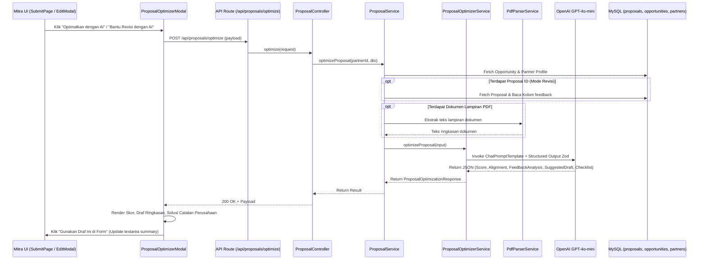

# AI Service: Proposal Optimizer & Revision Co-Pilot

Dokumentasi arsitektur, spesifikasi teknis, skema data, alur kerja prompt engineering, dan REST API untuk modul **AI Proposal Optimizer & Revision Co-Pilot** (`src/modules/ai/services/proposal-optimizer/`) dalam platform **Sipena**.

Layanan ini dirancang khusus bagi peran **Mitra Pelaksana (NGO / Komunitas)** untuk menyempurnakan proposal kemitraan CSR sebelum diajukan, serta membedah catatan evaluasi atau revisi dari perusahaan sponsor agar proposal memenuhi standar persetujuan.

---

## 1. Latar Belakang & Masalah

### Problem Statement
Bagi organisasi mitra pelaksana (NGO / Yayasan / Komunitas):
1. **Kesenjangan Bahasa Korporasi**: Mitra sering memiliki program lapangan yang bernilai tinggi, namun kesulitan merumuskan narasi proposal dan ringkasan metodologi dengan bahasa CSR korporasi yang terukur (berbasis output, outcome, dan pilar ESG/SDGs).
2. **Ketidaksesuaian Pagu & Ruang Lingkup**: Seringkali usulan anggaran (*proposed budget*) melebihi ekspektasi perusahaan atau alokasi komponen operasional dirasa kurang realistis terhadap durasi kegiatan.
3. **Kebingungan Menanggapi Revisi Perusahaan**: Ketika proposal berstatus `REVISION_REQUESTED`, catatan revisi dari tim CSR perusahaan terkadang padat dan membutuhkan penerjemahan ke langkah perbaikan nyata pada formulir usulan.

### Solusi Fitur AI Proposal Optimizer
1. **Skor Kesiapan Proposal (0-100) & Tingkat Keselarasan**: Mengukur keselarasan substansi proposal terhadap TOR dan parameter inisiatif perusahaan (`SANGAT_SELARAS`, `CUKUP_SELARAS`, `KURANG_SELARAS`).
2. **Bedah Catatan Evaluasi Perusahaan (Mode Revisi)**: AI menganalisis kolom `feedback` dari perusahaan, memetakan poin keberatan reviewer (*key concerns*), dan memberikan rekomendasi solusi konkrit (*suggested remedies*).
3. **Formulasi Draf Ringkasan yang Lebih Tajam**: AI menyusun ulang ringkasan proposal menjadi narasi persuasif terstruktur yang dapat disalin atau diterapkan langsung ke formulir dengan 1 klik (*1-click apply*).
4. **Saran Alokasi Anggaran (Budget Advice)**: Memberikan panduan rasionalisasi RAB berdasarkan pagu inisiatif perusahaan sponsor.
5. **Daftar Periksa Sebelum Pengajuan (*Pre-Submission Checklist*)**: Memastikan kelengkapan dokumen pendukung, kesesuaian durasi, dan kejelasan profil penerima manfaat sebelum submit final.

---

## 2. Penempatan Fitur (Dual-Context Placement)

Fitur ini diintegrasikan pada 2 titik interaksi mitra:

| Konteks | Komponen Antarmuka | Mode Kerja AI | Nilai Tambah bagi Mitra |
| :--- | :--- | :--- | :--- |
| **Pengajuan Proposal Baru** | `SubmitProposalPageView.tsx` | *AI Pre-Check & Optimizer* | Memastikan proposal siap bersaing dan selaras dengan TOR sebelum dikirimkan pertama kali. |
| **Revisi Proposal Masuk** | `EditProposalModal.tsx` | *AI Revision Co-Pilot* | Mengurai catatan keberatan perusahaan dan memberikan panduan teknis revisi poin per poin. |

---

## 3. Arsitektur Modul (`src/modules/ai/services/proposal-optimizer/`)

```text
src/modules/ai/
├── config/
│   └── openai.config.ts                         # Konfigurasi ChatOpenAI (gpt-4o-mini)
├── services/
│   ├── document-parser/
│   │   └── pdf-parser.service.ts                # Ekstraksi teks lampiran proposal PDF
│   ├── proposal-screener/                       # AI Screener untuk role Perusahaan
│   └── proposal-optimizer/                      # Sub-Layanan AI Optimizer untuk Mitra
│       ├── proposal-optimizer.schema.ts         # Skema Zod Structured Output
│       ├── proposal-optimizer.prompt.ts         # System Prompt CSR Proposal Consultant
│       ├── proposal-optimizer.service.ts        # Service LangChain & Heuristic Fallback
│       └── index.ts                             # Export Hub
├── ai.interface.ts                              # DTO Input & Response Global
└── index.ts                                     # AI Module Entrypoint
```

---

## 4. Diagram Alur Kerja (Optimization Pipeline)



---

## 5. Spesifikasi Output AI (`proposal-optimizer.schema.ts`)

```typescript
export interface ProposalOptimizationResult {
  readinessScore: number; // 0 - 100
  alignmentLevel: "HIGH" | "MEDIUM" | "LOW";
  overallAssessment: string;
  feedbackAnalysis?: {
    keyConcerns: string[];
    suggestedActions: string[];
  } | null;
  strengths: string[];
  improvementAreas: Array<{
    aspect: "NARASI_METODOLOGI" | "ANGGARAN_BIAYA" | "TARGET_PENERIMA" | "TIMELINE_DURASI" | "KESELARASAN_CSR";
    currentObservation: string;
    recommendation: string;
  }>;
  suggestedSummaryDraft: string;
  suggestedBudgetAdvice: string;
  preSubmissionChecklist: Array<{
    item: string;
    status: "READY" | "ACTION_REQUIRED" | "RECOMMENDED";
    notes: string;
  }>;
}

export interface ProposalOptimizationResponse extends ProposalOptimizationResult {
  source: "AI_OPENAI" | "HEURISTIC_FALLBACK";
  optimizedAt: string;
}
```

---

## 6. REST API Endpoint

### Endpoint: `POST /api/proposals/optimize`
- **Otorisasi**: Wajib Bearer Token JWT dengan role `PARTNER_ADMIN`.
- **Content-Type**: `application/json`

#### Request Body
```json
{
  "opportunityId": "550e8400-e29b-41d4-a716-446655440000",
  "proposalId": "c891a320-4712-4a0b-bcde-192837465012",
  "title": "Program Revitalisasi Terumbu Karang Teluk Ambon",
  "summary": "Kami mengusulkan program rehabilitasi terumbu karang dengan melibatkan kelompok nelayan pesisir...",
  "proposedBudget": 185000000,
  "durationMonths": 6,
  "targetBeneficiaries": "120 nelayan pesisir dan 3 desa binaan",
  "documentUrl": "/uploads/proposals/dokumen-proposal.pdf"
}
```

> **Catatan**: Field `proposalId` bersifat opsional. Jika diisi, backend otomatis membaca catatan perusahaan dari database (`proposals.feedback`) dan menjalankan mode bedah revisi (*feedback co-pilot*).

#### Contoh Response Sukses (`200 OK`):
```json
{
  "success": true,
  "statusCode": 200,
  "message": "Rekomendasi optimasi proposal berhasil digenerate",
  "data": {
    "readinessScore": 86,
    "alignmentLevel": "HIGH",
    "overallAssessment": "Proposal sangat selaras dengan pilar kelautan dan iklim perusahaan sponsor. Rancangan pelibatan kelompok nelayan lokal memberikan daya tawar keberlanjutan yang kuat.",
    "feedbackAnalysis": {
      "keyConcerns": [
        "Perusahaan meminta rincian frekuensi monitoring bibit karang pasca transplantasi.",
        "Komposisi anggaran operasional perlu dipertegas porsinya terhadap belanja modal media karang."
      ],
      "suggestedActions": [
        "Tambahkan jadwal patroli dan pengukuran survival rate karang setiap 2 minggu pada bulan ke-4 sampai ke-6.",
        "Sesuaikan rincian RAB dengan memindahkan 10% pos konsumsi rapat ke pengadaan media substrat karang ramah lingkungan."
      ]
    },
    "strengths": [
      "Metode transplantasi ramah lingkungan sesuai standar konservasi pesisir.",
      "Durasi 6 bulan sangat proporsional terhadap siklus penempelan polip karang."
    ],
    "improvementAreas": [
      {
        "aspect": "NARASI_METODOLOGI",
        "currentObservation": "Luas tutupan karang baru belum disebutkan secara spesifik dalam meter persegi.",
        "recommendation": "Cantumkan target luasan media tanam terumbu karang (contoh: 500 m2 media buatan dengan 1.200 fragmen)."
      }
    ],
    "suggestedSummaryDraft": "Program inisiatif konservasi laut terpadu berbasis masyarakat di Teluk Ambon melalui transplantasi 1.200 fragmen karang pada area seluas 500 m2 media buatan ramah lingkungan. Inisiatif ini memberdayakan 120 nelayan dari 3 desa pesisir sebagai penjaga karang mandiri, dilengkapi dengan protokol pemantauan survival rate berkala hingga bulan ke-6 guna menjamin kelestarian ekosistem dan keanekaragaman hayati laut.",
    "suggestedBudgetAdvice": "Anggaran sebesar Rp185.000.000 masih dalam rentang pagu estimasi perusahaan sponsor (Rp200.000.000). Pastikan pos pengadaan sarana lapangan mendominasi minimal 70% dari total pengeluaran.",
    "preSubmissionChecklist": [
      {
        "item": "Kesesuaian Pagu Anggaran",
        "status": "READY",
        "notes": "Total usulan anggaran berada di bawah batas pagu inisiatif perusahaan."
      },
      {
        "item": "Lampiran Dokumen Proposal & RAB",
        "status": "READY",
        "notes": "Berkas formal terunggah dan dapat dibaca sistem."
      }
    ],
    "source": "AI_OPENAI",
    "optimizedAt": "2026-11-09T14:40:00.000Z"
  }
}
```

---

## 7. Mekanisme Zero-Downtime Heuristic Fallback

Bila koneksi OpenAI terkendala, kuota habis, atau `OPENAI_API_KEY` tidak tersedia, sistem tidak akan mengalami error atau memutus alur pengguna:
1. `ProposalOptimizerService` menangkap kegagalan dan beralih ke `calculateHeuristicOptimization()`.
2. Mesin heuristik melakukan komparasi matematis antara pagu inisiatif dengan anggaran usulan, menghitung kelengkapan komponen proposal, serta mengekstraksi keberatan dari teks catatan revisi.
3. Menghasilkan skor kesiapan, checklist verifikasi, dan draf ringkasan proposal dengan label `source: "HEURISTIC_FALLBACK"` secara instan.
