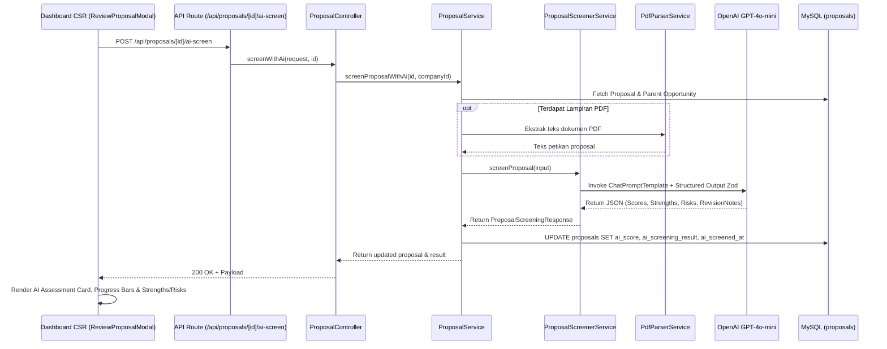

# 🤖 AI Service: Proposal Screener & Scoring Assistant

Dokumentasi arsitektur, spesifikasi teknis, skema database, alur kerja prompt engineering, dan REST API untuk modul **AI Proposal Screener & Scoring Assistant** dalam platform **Sipena**.

Fitur ini bertugas mengevaluasi, menganalisis keselarasan strategis, mengaudit kewajaran anggaran (RAB), mendeteksi potensi risiko (*red-flags*), dan memberikan skor kelayakan kuantitatif (0–100) secara otomatis pada proposal kemitraan CSR yang masuk dari mitra pelaksana.

---

## 1. Latar Belakang & Masalah

### Problem Statement
Dalam proses evaluasi proposal CSR konvensional:
1. **Beban Bacaan Tinggi**: CSR Manager menerima puluhan proposal PDF dengan ketebalan 20–50 halaman. Menelaah satu per satu membutuhkan waktu berhari-hari.
2. **Potensi Subjektivitas**: Penilaian seringkali bergantung pada intuisi pemeriksa tanpa tolok ukur skor yang standar.
3. **Risiko Anggaran & Greenwashing**: Seringkali ditemukan pos anggaran operasional yang membengkak atau metodologi kerja lapangan yang tidak realistis terhadap estimasi waktu.

### Solusi Fitur AI Screener
1. **Skor Kelayakan Multi-Dimensi (0–100)**: Evaluasi mencakup 4 pilar:
   - Keselarasan Strategis (*Strategic Alignment*)
   - Kewajaran Anggaran (*Budget Feasibility*)
   - Kelayakan Operasional (*Operational Feasibility*)
   - Keberlanjutan Dampak (*Impact Sustainability*)
2. **Ringkasan Eksekutif Instan**: Menghasilkan 2–3 kalimat padat yang merangkum esensi proposal bagi pengambil keputusan.
3. **Deteksi Keunggulan & Risiko**: Menyorot poin positif (*green flags*) serta potensi bahaya (*red flags*) secara transparan.
4. **Rekomendasi Catatan Revisi Siap Pakai**: Menghasilkan draf masukan perbaikan yang dapat disalin langsung oleh CSR Admin ke formulir revisi mitra dengan 1 klik.

---

## 2. Arsitektur Modul (`src/modules/ai/services/proposal-screener/`)

```text
src/modules/ai/
├── config/
│   └── openai.config.ts                      # Konfigurasi ChatOpenAI (gpt-4o-mini)
├── services/
│   ├── document-parser/
│   │   └── pdf-parser.service.ts             # Parser dokumen PDF proposal
│   ├── milestone-extraction/                 # Ekstraksi tahapan program
│   └── proposal-screener/                    # 🆕 Sub-Layanan AI Proposal Screener
│       ├── proposal-screener.schema.ts       # Skema Zod Structured Output
│       ├── proposal-screener.prompt.ts       # Prompt Template Senior CSR Auditor
│       └── proposal-screener.service.ts      # Logika LangChain & Heuristic Fallback
├── ai.interface.ts                           # Interface DTO Input & Response
└── index.ts                                  # Export Hub
```

---

## 3. Diagram Alur Kerja (Screening Pipeline)



---

## 4. Spesifikasi Output AI (`proposal-screener.schema.ts`)

```typescript
export interface ProposalScreeningResult {
  overallScore: number; // 0 - 100
  aspectScores: {
    strategicAlignment: number;     // 0 - 100
    budgetFeasibility: number;      // 0 - 100
    operationalFeasibility: number; // 0 - 100
    impactSustainability: number;   // 0 - 100
  };
  recommendation: 
    | "STRONGLY_RECOMMENDED"
    | "RECOMMENDED_WITH_REVISION"
    | "UNDER_CONSIDERATION"
    | "NOT_RECOMMENDED";
  recommendationLabel: string;
  executiveSummary: string;
  keyStrengths: string[];
  potentialRisks: string[];
  suggestedRevisionNotes?: string;
}
```

---

## 5. REST API Endpoint

### Endpoint: `POST /api/proposals/:id/ai-screen`
- **Otorisasi**: Wajib Bearer Token JWT dengan role `MANAGEMENT` atau `CSR_ADMIN`.
- **URL Parameter**: `id` (UUID Proposal).
- **Request Body**: Kosong (data diambil otomatis dari database berdasarkan `id` proposal dan perusahaan terkait).

#### Contoh Response Sukses (`200 OK`):
```json
{
  "success": true,
  "statusCode": 200,
  "message": "Evaluasi AI proposal berhasil dilakukan",
  "data": {
    "proposal": {
      "id": "prop-c891a-4712-bcde",
      "aiScore": 88,
      "aiScreenedAt": "2026-11-01T00:40:00.000Z"
    },
    "screeningResult": {
      "overallScore": 88,
      "aspectScores": {
        "strategicAlignment": 92,
        "budgetFeasibility": 85,
        "operationalFeasibility": 86,
        "impactSustainability": 89
      },
      "recommendation": "STRONGLY_RECOMMENDED",
      "recommendationLabel": "Sangat Direkomendasikan",
      "executiveSummary": "Proposal memiliki keselarasan sangat tinggi dengan target restorasi pesisir dan pilar SDG 13/14. Rencana keterlibatan kelompok nelayan lokal memberikan jaminan keberlanjutan dampak yang kuat.",
      "keyStrengths": [
        "Metodologi pembibitan Rhizophora terstandarisasi dengan target survival rate >85%.",
        "Partisipasi aktif 3 desa pesisir memperkuat kepemilikan lokal program.",
        "Rasio biaya per penerima manfaat sangat efisien dibanding benchmark wilayah."
      ],
      "potentialRisks": [
        "Jadwal penanaman pada bulan ke-3 rentan terganggu musim ombak pasang jika tidak ada penahan gelombang sementara."
      ],
      "suggestedRevisionNotes": "Disarankan menambahkan klausul mitigasi cuaca ekstrem pada jadwal penanaman lapangan.",
      "source": "AI_OPENAI"
    }
  }
}
```

---

## 6. Fitur Heuristic Fallback (Zero Downtime)

Jika `OPENAI_API_KEY` belum terpasang atau kuota OpenAI sedang habis, layanan tidak akan *crash*. Modul `ProposalScreenerService` otomatis mengaktifkan **Heuristic Engine**:
1. Membandingkan rasio usulan anggaran proposal terhadap pagu inisiatif perusahaan.
2. Memeriksa kelengkapan narasi ringkasan teknis dan durasi bulan.
3. Mengembalikan analisis berstruktur lengkap dengan `source: "HEURISTIC_FALLBACK"` sehingga pengguna tetap mendapatkan rekomendasi dan pengalaman antarmuka yang mulus.
