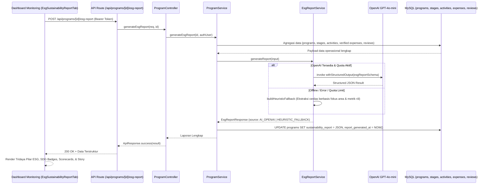

# 🤖 AI Service: Sustainability & ESG Report Generator

Dokumentasi arsitektur, spesifikasi teknis, skema data, integrasi prompt engineering, dan REST API untuk modul **AI Sustainability & ESG Report Generator** dalam platform **Sipena (Project CSR)**.

Fitur ini bertugas mengumpulkan data operasional program secara holistik (log kegiatan lapangan, nota kuitansi belanja terverifikasi, suara ulasan warga, dan persentase penyelesaian milestone), lalu menyusun **Laporan Keberlanjutan & Dampak ESG resmi** berbasis standar **POJK 51/POJK.03/2017**, **Global Reporting Initiative (GRI Standards)**, dan **UN Sustainable Development Goals (SDGs)** secara otomatis.

---

## 1. Latar Belakang & Masalah Bisnis

### Problem Statement
Dalam tata kelola CSR korporat konvensional:
1. **Penyusunan Laporan Sangat Lambat**: Menjelang akhir tahun buku, tim CSR menghabiskan berminggu-minggu mengumpulkan kuitansi fisik, berkas dokumentasi foto, dan rekapitulasi Excel dari berbagai mitra pelaksana di daerah.
2. **Ketiadaan Standarisasi ESG & SDG**: Laporan seringkali hanya berbentuk narasi seremonial tanpa justifikasi kuantitatif yang terukur terhadap indikator keberlanjutan (SDG Goals 1–17) dan kepatuhan POJK 51 OJK.
3. **Data Tercecer & Tidak Terverifikasi**: Angka penerima manfaat seringkali hanya estimasi tanpa keterkaitan langsung dengan log aktivitas terverifikasi dan testimoni nyata masyarakat penerima manfaat.

### Solusi Fitur AI ESG Report Generator
1. **Sintesis Berbasis Data Nyata (*Grounded Evidence*)**: AI mengekstrak data riil dari 5 tabel operasional: `programs`, `program_stages`, `program_activities`, `program_expenses`, dan `program_reviews`.
2. **Penyelarasan 3 Pilar ESG**:
   - **Environmental (E)**: Dampak kelestarian lingkungan, efisiensi sumber daya, dan restorasi ekosistem.
   - **Social (S)**: Peningkatan kualitas hidup, pemerataan akses edukasi/kesehatan, dan pemberdayaan ekonomi komunitas.
   - **Governance (G)**: Transparansi penyerapan anggaran, kelengkapan nota belanja terverifikasi, dan akuntabilitas multi-pihak.
3. **Pemetaan Resmi UN SDGs**: Mengidentifikasi 1 Target SDG Utama beserta justifikasinya dan 1–3 SDG Sekunder pendukung.
4. **Metrik Dampak & Efisiensi Biaya**: Menghitung rasio serapan pagu, biaya per jiwa penerima manfaat (*Cost per Beneficiary*), dan Indeks Kepuasan Warga (*Beneficiary Satisfaction Score*).
5. **Kisah Perubahan Nyata (*Human Interest / Success Story*)**: Menghasilkan studi kasus humanis sebelum vs sesudah program berjalan dengan kutipan langsung warga lokal.
6. **Siap Cetak PDF Eksekutif**: Format cetak `@media print` bergaya laporan tahunan resmi lengkap dengan ruang tanda tangan legalitas Direksi Perusahaan Sponsor dan Pimpinan Mitra Pelaksana.

---

## 2. Struktur Modul (`src/modules/ai/services/esg-report/`)

```text
src/modules/ai/
├── config/
│   └── openai.config.ts                      # Konfigurasi ChatOpenAI (gpt-4o-mini, temperature: 0.2)
├── services/
│   ├── document-parser/                      # Parser PDF
│   ├── milestone-extraction/                 # Ekstraksi tahapan program dari proposal
│   ├── proposal-screener/                    # Evaluasi proposal kemitraan
│   └── esg-report/                           # 🆕 Layanan AI ESG Sustainability Report
│       ├── esg-report.schema.ts              # Zod Schema output terstruktur (POJK 51, GRI, SDG)
│       ├── esg-report.prompt.ts              # Prompt template Senior ESG Auditor & Specialist
│       └── esg-report.service.ts             # Logika LangChain & Heuristic Fallback Engine
├── ai.interface.ts                           # Interface EsgReportInput & EsgReportResponse
└── index.ts                                  # Export Hub
```

---

## 3. Diagram Alur Kerja (Pipeline Penyusunan Laporan)



---

## 4. Spesifikasi REST API Endpoint

### 1. Generate / Regenerate Laporan ESG
* **URL**: `/api/programs/:id/esg-report`
* **Method**: `POST`
* **Headers**: `Authorization: Bearer <accessToken>`
* **Role Diizinkan**: `MANAGEMENT`, `CSR_ADMIN`
* **Response Sukses (200 OK)**:
```json
{
  "success": true,
  "message": "Laporan Keberlanjutan & Dampak ESG berhasil disusun oleh AI",
  "data": {
    "executiveSummary": "Program CSR 'Restorasi Mangrove Pesisir' yang diinisiasi oleh PT Indotama bersama Yayasan Bahari Lestari...",
    "programHighlight": "Keberhasilan penanaman 10.000 bibit mangrove dengan tingkat kelangsungan hidup 94%...",
    "esgBreakdown": {
      "environmentalImpact": "Mencegah abrasi pantai sepanjang 2,5 km dan menyerap potensi emisi karbon...",
      "socialImpact": "Melibatkan 150 nelayan lokal dalam kelompok pembibitan swadaya...",
      "governanceTransparency": "Seluruh serapan dana sebesar Rp 185.000.000 terverifikasi dengan 14 kuitansi valid..."
    },
    "primarySdg": {
      "goalNumber": 13,
      "goalTitle": "SDG 13: Penanganan Perubahan Iklim",
      "alignmentRationale": "Restorasi sabuk hijau pesisir meningkatkan ketahanan komunitas terhadap gelombang ekstrem..."
    },
    "secondarySdgs": [
      {
        "goalNumber": 14,
        "goalTitle": "SDG 14: Ekosistem Lautan",
        "description": "Menyediakan habitat asuh (*nursery ground*) bagi biota laut lokal."
      }
    ],
    "metrics": {
      "beneficiariesReached": 450,
      "budgetEfficiencyRating": "EXCELLENT",
      "costPerBeneficiaryFormatted": "Rp 411.111 / jiwa",
      "beneficiarySatisfactionScore": 96,
      "overallEsgScore": 92
    },
    "successStory": {
      "headline": "Nelayan Dusun Karang Menemukan Harapan Baru Melalui Mangrove",
      "narrative": "Sebelum intervensi program, tambak warga kerap terendam air pasang rob...",
      "beneficiaryQuote": "\"Sekarang ombak tertahan akar mangrove, dan kepiting bakau mulai banyak kembali.\""
    },
    "challengesFaced": [
      "Tingginya pasang surut air laut pada bulan purnama menuntut penguatan ajir penahan bibit."
    ],
    "futureRecommendations": [
      "Mengembangkan ekowisata mangrove berbasis masyarakat untuk diversifikasi pendapatan nelayan."
    ],
    "source": "AI_OPENAI"
  }
}
```

### 2. Ambil Laporan yang Tersimpan
* **URL**: `/api/programs/:id/esg-report`
* **Method**: `GET`
* **Headers**: `Authorization: Bearer <accessToken>`
* **Role Diizinkan**: `MANAGEMENT`, `CSR_ADMIN`, `PARTNER_ADMIN`
* **Response**: Mengembalikan laporan yang sudah pernah digenerate dari basis data tanpa memanggil model LLM berulang kali.

---

## 5. Skema Database

Tabel `programs` ditambahkan dua kolom baru:
```sql
ALTER TABLE programs 
ADD COLUMN sustainability_report TEXT NULL,
ADD COLUMN report_generated_at TIMESTAMP NULL;
```
* **`sustainability_report`**: Menyimpan serialisasi JSON hasil evaluasi AI.
* **`report_generated_at`**: Timestamp waktu pelaporan disusun oleh AI.

---

## 6. Antarmuka Pengguna (UI/UX)

Komponen UI terletak pada:
`src/components/dashboard/company/programs/EsgSustainabilityReportTab.tsx`

Terintegrasi di dalam [ProgramMonitoringDetailView.tsx](file:///c:/Users/Pongo/Documents/projects/next.js/project-csr/src/components/dashboard/company/programs/ProgramMonitoringDetailView.tsx) sebagai:
1. **Quick Action Header**: Tombol `[ ✨ Laporan ESG (AI) ]` di bilah atas monitoring.
2. **Tab Khusus ke-5**: Tab *"Laporan Keberlanjutan & ESG (AI)"* berdampingan dengan tab Log Aktivitas, Realisasi Keuangan, dan Ulasan Warga.
3. **Card Triptych 3 Pilar ESG**: Tampilan visual hijau (*Environment*), biru (*Social*), dan ungu (*Governance*).
4. **Official UN SDG Badges**: Warna resmi sesuai pedoman visual Perserikatan Bangsa-Bangsa.
5. **Mode Cetak / Print Resmi**: Dioptimalkan untuk `window.print()` / `Ctrl + P` dengan kop surat formal, penomoran standar POJK 51, dan ruang pengesahan tanda tangan Direksi.
