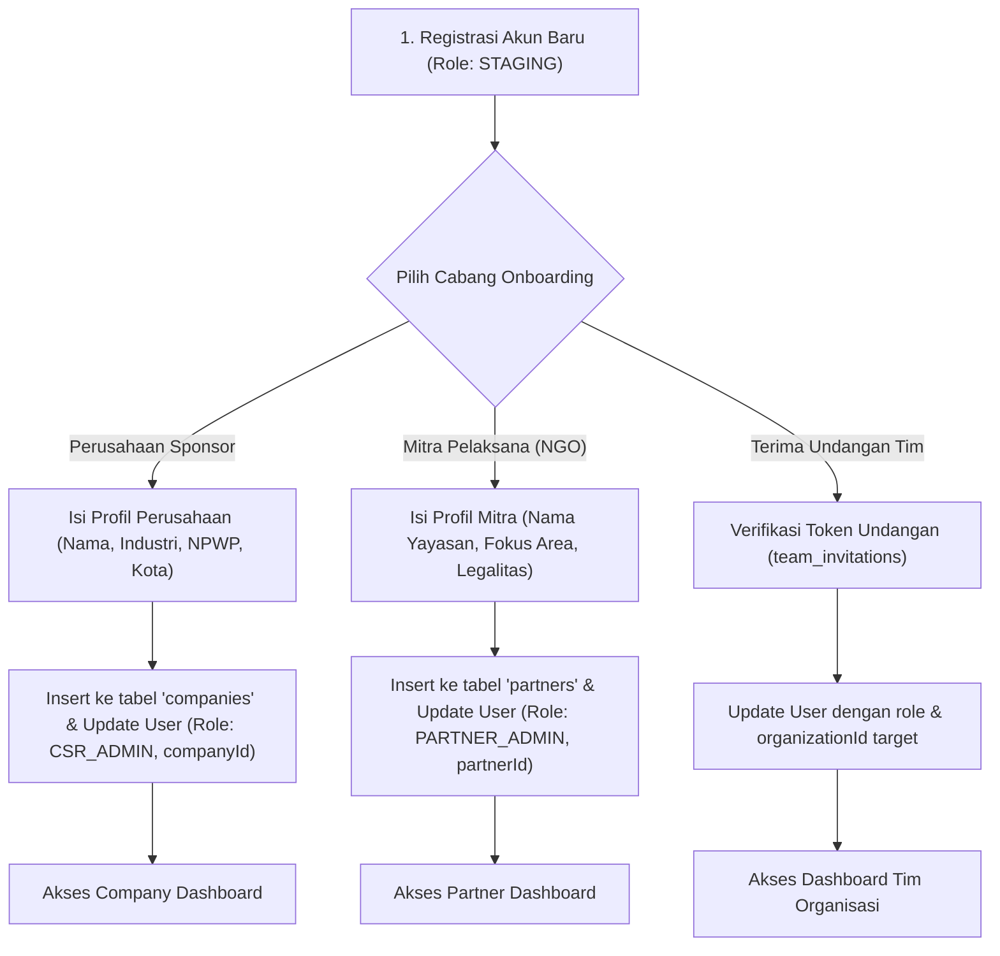
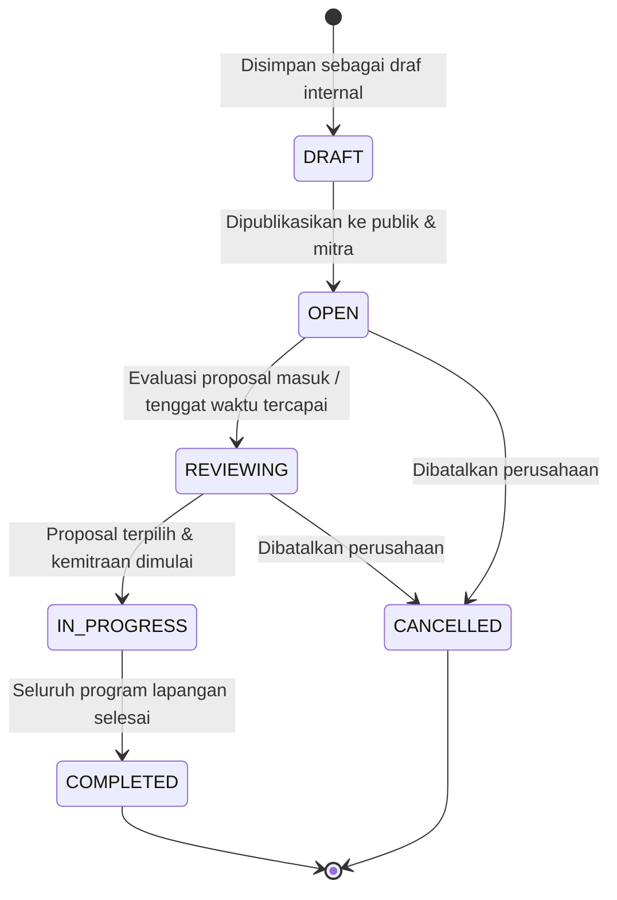
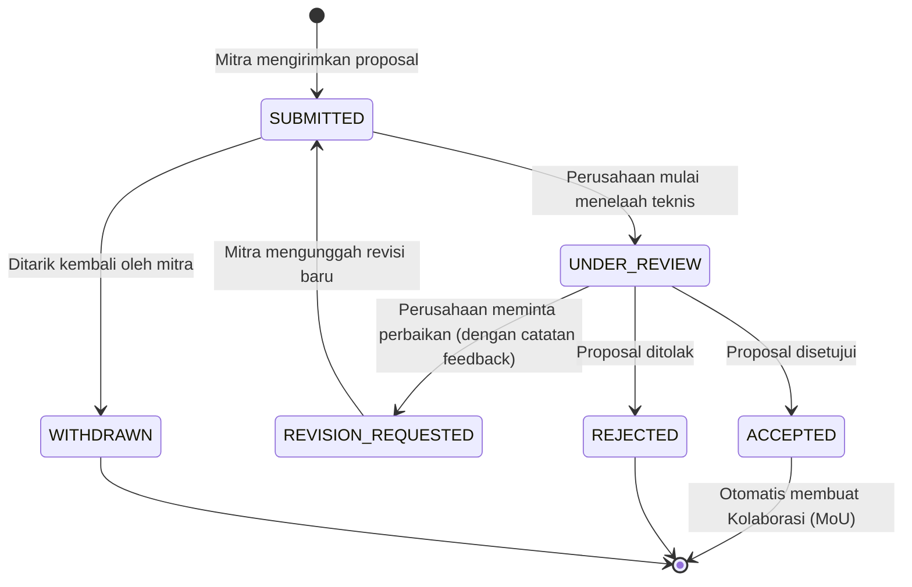
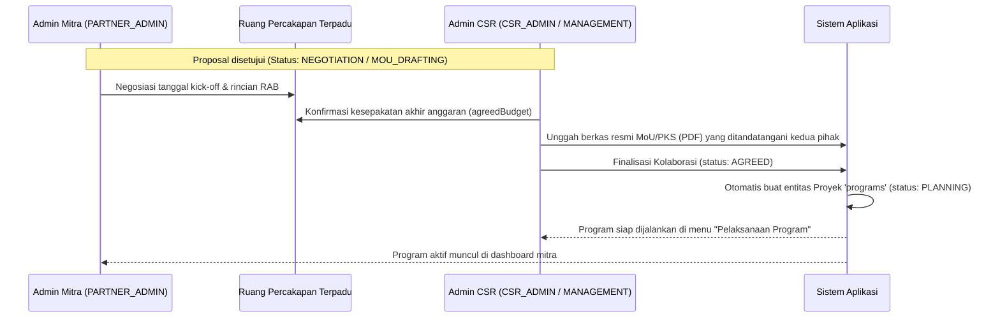
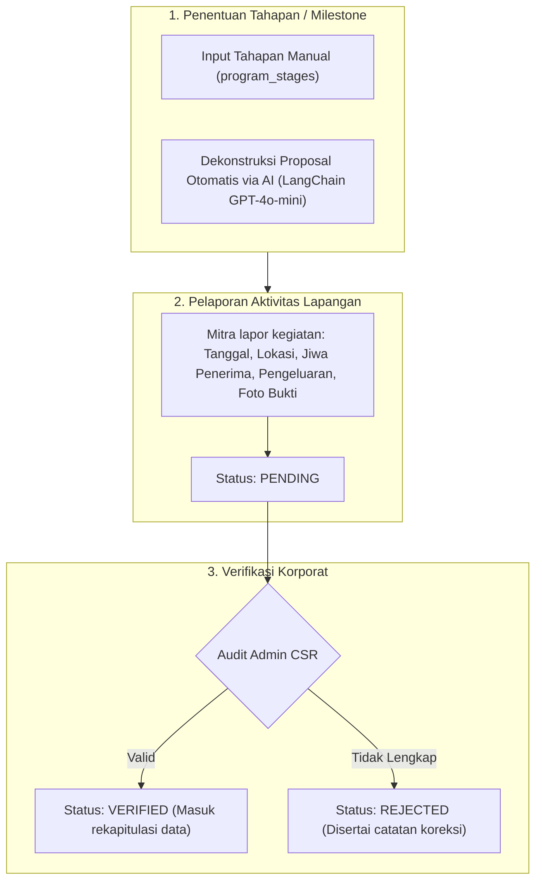
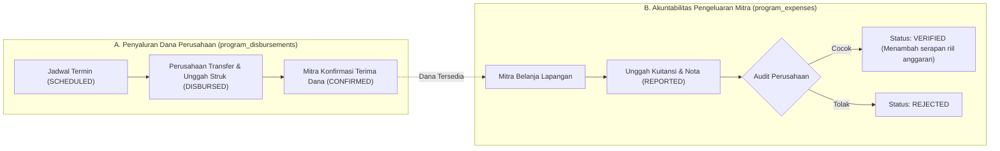
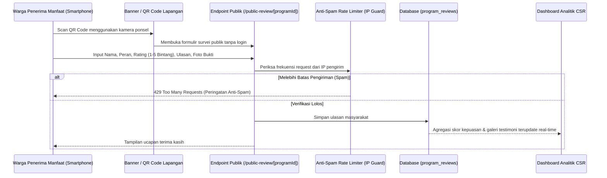

# 🔄 Business Workflows & State Machines — Project CSR (Sipena)

Dokumentasi ini menguraikan siklus hidup proses bisnis (*business lifecycles*), alur transisi status (*state machines*), dan interaksi antar-pengguna dalam platform **Sipena**.

---

## 1. Siklus Onboarding & Staging Organisasi

Setiap pengguna yang baru mendaftar (`POST /api/register`) secara otomatis memiliki peran **`STAGING`**. Pengguna belum dapat mengakses fitur inti sampai menyelesaikan salah satu dari 3 cabang onboarding:

---

## 2. Siklus Hidup Inisiatif CSR (Opportunity Lifecycle)

Tabel `opportunities` mengelola inisiatif pendanaan yang dipublikasikan oleh perusahaan sponsor:

- **`DRAFT`**: Inisiatif baru dirancang oleh tim CSR, belum dapat dilihat oleh mitra pelaksana.
- **`OPEN`**: Terbuka untuk pengajuan proposal umum. Perusahaan juga dapat mengirimkan undangan eksklusif (`opportunity_invitations`) ke mitra berperingkat tinggi.
- **`REVIEWING`**: Perusahaan sedang menyeleksi proposal yang masuk.
- **`IN_PROGRESS`**: Telah ada proposal yang disetujui dan dialihkan ke tahap eksekusi program.
- **`COMPLETED`**: Program telah selesai dipertanggungjawabkan.

---

## 3. Siklus Hidup Proposal Masuk (Proposal Lifecycle)

Tabel `proposals` merekam usulan kegiatan dari mitra pelaksana beserta usulan anggaran (RAB):

### Aturan Bisnis Penting:
1. **Otomasi Kolaborasi Baru**: Saat proposal diubah statusnya menjadi **`ACCEPTED`**, sistem secara transaksional membuat baris baru pada tabel `collaborations` dengan status awal `NEGOTIATION` / `MOU_DRAFTING`.
2. **Revisi Dua Arah**: Saat perusahaan memilih `REVISION_REQUESTED`, kolom `feedback` wajib diisi minimal 5 karakter. Ketika mitra menyimpan hasil revisi, status proposal secara otomatis kembali ke `SUBMITTED` agar tim perusahaan mengetahui adanya pembaruan.
3. **Penarikan Mandiri**: Mitra hanya dapat menarik proposal (`WITHDRAWN`) jika proposal belum mencapai status `ACCEPTED` atau `REJECTED`.

---

## 4. Siklus Finalisasi MoU & Pembuatan Program Otomatis

Tabel `collaborations` menjembatani kesepakatan formal antara perusahaan dan mitra:

---

## 5. Eksekusi Program, Dekonstruksi AI, & Linimasa Lapangan

Setelah program terbentuk (`programs`), eksekusi kegiatan diatur dalam tahapan (*stages*) dan log aktivitas (*activities*):

---

## 6. Realisasi Keuangan Bertahap (Disbursements & Expenses)

Sistem memastikan tata kelola keuangan yang transparan dan akuntabel melalui pemisahan antara **Pencairan Termin** dan **Pelaporan Belanja**:

- **Pagu Alokasi**: Total komitmen anggaran program (`totalBudget`).
- **Dana Tersalurkan**: Akumulasi termin yang berstatus `CONFIRMED`.
- **Dana Terserap Riil**: Akumulasi nota belanja yang berstatus `VERIFIED`.

---

## 7. Survei Kepuasan Masyarakat Tanpa Login (Public QR Review)

Platform memfasilitasi pengumpulan umpan balik langsung dari masyarakat di lokasi kegiatan:

---

## 8. Laporan & Visualisasi Analitik ESG (Executive Analytics)

Modul `analytics` merangkum metrik kuantitatif dan kualitatif dari seluruh program aktif dan selesai:
1. **Total Penerima Manfaat (Jiwa)**: Dihitung dari akumulasi penerima manfaat terverifikasi pada tabel `program_activities` dan target inisiatif.
2. **Efisiensi Serapan Anggaran**: Perbandingan realisasi pengeluaran terhadap komitmen awal.
3. **Distribusi Pilar ESG & SDG**: Diagram komposisi portofolio (Lingkungan, Pendidikan, Kesehatan, Ekonomi).
4. **Alat Pelaporan**:
   - **Ekspor CSV**: Menghasilkan data mentah terstruktur untuk integrasi ke spreadsheet/BI tool.
   - **Mode Cetak Laporan Resmi**: Tampilan bersih bebas navigasi yang dioptimalkan untuk dicetak langsung ke PDF atau printer fisik sebagai lampiran laporan tahunan (*Sustainability Report*).
