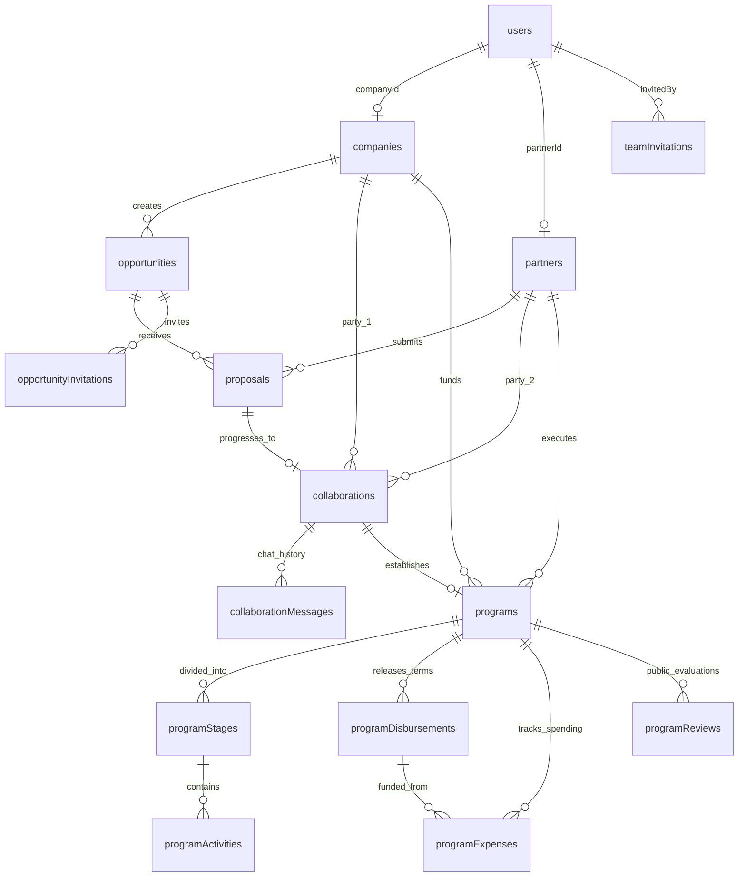

# 🗄️ Database Schema & Data Dictionary — Project CSR (Sipena)

Dokumentasi ini menjelaskan skema basis data relasional MySQL yang dikelola menggunakan **Drizzle ORM**, mencakup Entity-Relationship Diagram (ERD), kamus data 16 tabel, enum status, dan konvensi query.

---

## 1. Entity-Relationship Diagram (ERD)

---

## 2. Kamus Data Master Enum (*Global Enums*)

Seluruh enum didefinisikan secara type-safe di `src/db/schema/`:

### A. Role Pengguna (`src/db/schema/users.ts`)
| Enum Value | Deskripsi |
| :--- | :--- |
| `STAGING` | Akun baru terdaftar (belum memilih atau terhubung ke organisasi). |
| `CSR_ADMIN` | Staf operasional CSR perusahaan. |
| `MANAGEMENT` | Pimpinan/Direksi eksekutif perusahaan sponsor. |
| `PARTNER_ADMIN` | Pengelola yayasan/organisasi nirlaba/mitra pelaksana. |

### B. Bidang Fokus CSR (`src/db/schema/csr-focus-areas.ts`)
| Enum Value | Label Tampilan | Keterangan SDG / Pilar CSR |
| :--- | :--- | :--- |
| `POVERTY` | Pengentasan Kemiskinan | SDG 1: No Poverty |
| `EDUCATION` | Pendidikan Berkualitas | SDG 4: Quality Education |
| `HEALTH` | Kesehatan & Kesejahteraan | SDG 3: Good Health and Well-being |
| `ENVIRONMENT` | Lingkungan & Energi Hijau | SDG 13, 14, 15: Climate Action & Life On Land/Water |
| `EMPOWERMENT` | Pemberdayaan Ekonomi & UMKM | SDG 8: Decent Work and Economic Growth |
| `INFRASTRUCTURE`| Sarana & Infrastruktur Sosial | SDG 9: Industry, Innovation, and Infrastructure |
| `DISASTER` | Tanggap Darurat & Bencana | Bantuan logistik & rehabilitasi bencana |
| `OTHER` | Inisiatif Keberlanjutan Lainnya| Kategori program umum |

---

## 3. Rincian Tabel Database (`src/db/schema/`)

### 1. `users` — Data Pengguna Sistem
Menyimpan kredensial autentikasi pengguna dan pemetaan ke organisasi.
- `id` (VARCHAR(36), PK): UUID unik.
- `name` (VARCHAR(255), NOT NULL): Nama lengkap pengguna.
- `email` (VARCHAR(255), NOT NULL, UNIQUE): Email untuk login.
- `password` (VARCHAR(255), NOT NULL): Password hash (Bcrypt).
- `role` (ENUM, NOT NULL, DEFAULT `'STAGING'`): Role RBAC pengguna.
- `companyId` (VARCHAR(36), FK $\rightarrow$ `companies.id`, NULLABLE): ID perusahaan (jika role CSR).
- `partnerId` (VARCHAR(36), FK $\rightarrow$ `partners.id`, NULLABLE): ID mitra (jika role mitra).
- `status` (VARCHAR(50), NOT NULL, DEFAULT `'ACTIVE'`): Status aktif pengguna.
- `createdAt`, `updatedAt` (TIMESTAMP).

### 2. `companies` — Profil Perusahaan Sponsor
- `id` (VARCHAR(36), PK): UUID unik perusahaan.
- `name` (VARCHAR(255), NOT NULL): Nama resmi perseroan.
- `email`, `phone` (VARCHAR(255), NULLABLE): Kontak korporat.
- `address`, `city`, `province` (VARCHAR, NULLABLE): Domisili kantor pusat.
- `website`, `logoUrl`, `coverUrl` (TEXT, NULLABLE): Identitas visual korporat.
- `description`, `industry` (TEXT, VARCHAR): Sektor industri & visi keberlanjutan.
- `npwpNumber`, `foundedYear` (VARCHAR, INT): Legalitas korporat.
- `status` (VARCHAR(50), DEFAULT `'ACTIVE'`).

### 3. `partners` — Profil Mitra Pelaksana / Lembaga NGO
- `id` (VARCHAR(36), PK): UUID unik lembaga mitra.
- `name` (VARCHAR(255), NOT NULL): Nama yayasan/komunitas.
- `email`, `phone`, `address`, `city`, `province` (VARCHAR, NULLABLE): Kontak & domisili.
- `website`, `logoUrl`, `coverUrl` (TEXT, NULLABLE): Branding lembaga.
- `description`, `organizationType` (TEXT, VARCHAR): Jenis lembaga (`YAYASAN`, `KOMUNITAS`, `LSM`).
- `foundedYear`, `legalNumber`, `npwpNumber` (INT, VARCHAR): Bukti legalitas Kemenkumham & NPWP.
- `instagramUrl`, `linkedinUrl`, `youtubeUrl`, `portfolioDocUrl` (TEXT, NULLABLE): Tautan sosial & berkas rekam jejak.
- `focusArea` (ENUM `csrFocusAreaEnum`, NOT NULL, DEFAULT `'OTHER'`): Fokus utama lembaga.
- `status` (VARCHAR(50), DEFAULT `'ACTIVE'`).

### 4. `team_invitations` — Undangan Bergabung Anggota Tim
- `id` (VARCHAR(36), PK): UUID undangan.
- `email` (VARCHAR(255), NOT NULL): Email rekan yang diundang.
- `role` (ENUM, NOT NULL): Role yang akan diberikan setelah klaim.
- `companyId`, `partnerId` (VARCHAR(36), NULLABLE): Organisasi target.
- `token` (VARCHAR(255), NOT NULL, UNIQUE): Token rahasia undangan.
- `expiresAt` (TIMESTAMP, NOT NULL): Waktu kedaluwarsa token (misal: 7 hari).
- `status` (ENUM: `'PENDING'`, `'ACCEPTED'`, `'EXPIRED'`, `'CANCELLED'`).
- `invitedBy` (VARCHAR(36), FK $\rightarrow$ `users.id`).

### 5. `opportunities` — Inisiatif & Peluang CSR Terbuka
- `id` (VARCHAR(36), PK): UUID inisiatif.
- `companyId` (VARCHAR(36), FK $\rightarrow$ `companies.id`, NOT NULL): Perusahaan penyelenggara.
- `title` (VARCHAR(255), NOT NULL): Nama inisiatif program CSR.
- `description` (TEXT, NOT NULL): Panduan kriteria dan latar belakang inisiatif.
- `focusArea` (ENUM `csrFocusAreaEnum`, NOT NULL): Pilar pilar CSR / SDG.
- `targetBeneficiaries` (VARCHAR(255), NULLABLE): Target sasaran penerima manfaat.
- `estimatedBudget` (DECIMAL(15,2), NOT NULL): Estimasi pagu anggaran pendanaan.
- `startDate`, `endDate` (TIMESTAMP, NULLABLE): Rencana periode pelaksanaan.
- `locationProvince`, `locationCity` (VARCHAR, NULLABLE): Lokasi geografis program.
- `status` (ENUM: `'DRAFT'`, `'OPEN'`, `'REVIEWING'`, `'IN_PROGRESS'`, `'COMPLETED'`, `'CANCELLED'`).

### 6. `opportunity_invitations` — Undangan Eksklusif Pitching Mitra
- `id` (VARCHAR(36), PK): UUID undangan.
- `opportunityId` (VARCHAR(36), FK $\rightarrow$ `opportunities.id`).
- `partnerId` (VARCHAR(36), FK $\rightarrow$ `partners.id`).
- `invitedBy` (VARCHAR(36), FK $\rightarrow$ `users.id`).
- `message` (TEXT, NULLABLE): Catatan undangan kurasi.
- `status` (ENUM: `'INVITED'`, `'ACCEPTED'`, `'DECLINED'`).

### 7. `proposals` — Proposal Masuk dari Mitra
- `id` (VARCHAR(36), PK): UUID proposal.
- `opportunityId` (VARCHAR(36), FK $\rightarrow$ `opportunities.id`, NOT NULL).
- `partnerId` (VARCHAR(36), FK $\rightarrow$ `partners.id`, NOT NULL).
- `submittedBy` (VARCHAR(36), FK $\rightarrow$ `users.id`, NOT NULL).
- `title` (VARCHAR(255), NOT NULL): Judul kegiatan yang diusulkan.
- `summary` (TEXT, NOT NULL): Ringkasan teknis & metodologi kerja.
- `proposedBudget` (DECIMAL(15,2), NOT NULL): Usulan total RAB (Rupiah).
- `durationMonths` (INT, NULLABLE): Durasi pelaksanaan dalam bulan.
- `targetBeneficiaries` (VARCHAR(255), NULLABLE): Deskripsi sasaran warga.
- `documentUrl` (TEXT, NULLABLE): Tautan berkas proposal PDF atau Google Docs.
- `feedback` (TEXT, NULLABLE): Catatan evaluasi / poin revisi dari reviewer perusahaan.
- `status` (ENUM: `'SUBMITTED'`, `'UNDER_REVIEW'`, `'REVISION_REQUESTED'`, `'ACCEPTED'`, `'REJECTED'`, `'WITHDRAWN'`).
- `reviewedBy` (VARCHAR(36), FK $\rightarrow$ `users.id`, NULLABLE): PIC peninjau.
- `reviewedAt` (TIMESTAMP, NULLABLE): Waktu peninjauan terakhir.

### 8. `collaborations` — Kemitraan & Perjanjian Kerjasama (MoU)
- `id` (VARCHAR(36), PK): UUID kolaborasi.
- `opportunityId` (VARCHAR(36), FK $\rightarrow$ `opportunities.id`).
- `proposalId` (VARCHAR(36), FK $\rightarrow$ `proposals.id`).
- `companyId` (VARCHAR(36), FK $\rightarrow$ `companies.id`).
- `partnerId` (VARCHAR(36), FK $\rightarrow$ `partners.id`).
- `agreementDocumentUrl` (TEXT, NULLABLE): Berkas resmi MoU/PKS yang sudah ditandatangani.
- `agreedBudget` (DECIMAL(15,2), NULLABLE): Nilai anggaran final yang disepakati.
- `startDate`, `endDate` (TIMESTAMP, NULLABLE): Jadwal resmi kemitraan.
- `status` (ENUM: `'NEGOTIATION'`, `'MOU_DRAFTING'`, `'AGREED'`, `'REJECTED'`, `'TERMINATED'`).
- `finalizedBy` (VARCHAR(36), FK $\rightarrow$ `users.id`).
- `finalizedAt` (TIMESTAMP).

### 9. `collaboration_messages` — Ruang Percakapan & Negosiasi
- `id` (VARCHAR(36), PK): UUID pesan chat.
- `collaborationId` (VARCHAR(36), FK $\rightarrow$ `collaborations.id`, NOT NULL).
- `senderId` (VARCHAR(36), FK $\rightarrow$ `users.id`, NOT NULL).
- `message` (TEXT, NOT NULL): Isi teks obrolan.
- `attachmentUrl` (TEXT, NULLABLE): Berkas lampiran dalam chat.

### 10. `programs` — Proyek Eksekusi Lapangan
- `id` (VARCHAR(36), PK): UUID program aktif.
- `collaborationId` (VARCHAR(36), FK $\rightarrow$ `collaborations.id`, NOT NULL).
- `companyId` (VARCHAR(36), FK $\rightarrow$ `companies.id`, NOT NULL).
- `partnerId` (VARCHAR(36), FK $\rightarrow$ `partners.id`, NOT NULL).
- `name` (VARCHAR(255), NOT NULL): Nama program lapangan.
- `description` (TEXT, NOT NULL): Latar belakang program.
- `focusArea` (ENUM `csrFocusAreaEnum`, NOT NULL).
- `targetBeneficiaries` (VARCHAR(255), NULLABLE): Target warga terdampak.
- `totalBudget` (DECIMAL(15,2), NOT NULL): Komitmen pagu anggaran.
- `allocatedBudget` (DECIMAL(15,2), DEFAULT `'0.00'`): Total dana yang sudah dialokasikan/diserap.
- `startDate`, `endDate` (TIMESTAMP, NULLABLE): Tanggal kick-off & target penutupan.
- `locationProvince`, `locationCity` (VARCHAR, NULLABLE): Koordinat wilayah kerja.
- `status` (ENUM: `'PLANNING'`, `'ACTIVE'`, `'ON_HOLD'`, `'COMPLETED'`, `'CANCELLED'`).

### 11. `program_stages` — Tahapan Kerja / Milestone Program
- `id` (VARCHAR(36), PK): UUID tahapan.
- `programId` (VARCHAR(36), FK $\rightarrow$ `programs.id`, NOT NULL).
- `title` (VARCHAR(255), NOT NULL): Nama tahapan kerja (misal: "Sosialisasi & Pendataan Warga").
- `description` (TEXT, NULLABLE): Sasaran output tahapan.
- `orderIndex` (INT, NOT NULL, DEFAULT 0): Urutan kronologis milestone.
- `targetDate` (TIMESTAMP, NULLABLE): Tenggat waktu target selesai.
- `completedDate` (TIMESTAMP, NULLABLE): Tanggal riil penyelesaian.
- `status` (ENUM: `'PENDING'`, `'IN_PROGRESS'`, `'COMPLETED'`).

### 12. `program_activities` — Log Aktivitas & Bukti Kegiatan Lapangan
- `id` (VARCHAR(36), PK): UUID aktivitas.
- `stageId` (VARCHAR(36), FK $\rightarrow$ `program_stages.id`, NOT NULL).
- `reportedBy` (VARCHAR(36), FK $\rightarrow$ `users.id`, NOT NULL).
- `title` (VARCHAR(255), NOT NULL): Judul kegiatan spesifik.
- `description` (TEXT, NOT NULL): Narasi laporan kemajuan.
- `activityDate` (TIMESTAMP, NOT NULL): Tanggal pelaksanaan kegiatan.
- `locationName` (VARCHAR(255), NULLABLE): Nama desa/lokasi spesifik.
- `beneficiariesCount` (INT, DEFAULT 0): Jumlah riil warga yang hadir/menerima bantuan.
- `budgetSpent` (DECIMAL(15,2), DEFAULT `'0.00'`): Biaya yang terpakai pada sesi ini.
- `photoUrl` (TEXT, NULLABLE): Dokumentasi foto lapangan.
- `status` (ENUM: `'PENDING'`, `'VERIFIED'`, `'REJECTED'`): Status validasi auditor CSR.
- `verificationNotes` (TEXT, NULLABLE): Catatan koreksi/apresiasi auditor.
- `verifiedBy` (VARCHAR(36), FK $\rightarrow$ `users.id`, NULLABLE).
- `verifiedAt` (TIMESTAMP, NULLABLE).

### 13. `program_disbursements` — Penyaluran Dana Termin Perusahaan
- `id` (VARCHAR(36), PK): UUID pencairan dana.
- `programId` (VARCHAR(36), FK $\rightarrow$ `programs.id`, NOT NULL).
- `termNumber` (INT, NOT NULL): Termin ke- (1, 2, 3, dst).
- `title` (VARCHAR(255), NOT NULL): Keterangan termin (misal: "Termin I - Uang Muka Operasional 40%").
- `amount` (DECIMAL(15,2), NOT NULL): Nominal dana yang dicairkan.
- `targetDate` (TIMESTAMP, NULLABLE): Jadwal target transfer.
- `bankName`, `accountNumber`, `accountHolderName` (VARCHAR, NULLABLE): Rekening bank tujuan mitra.
- `transferProofUrl` (TEXT, NULLABLE): Foto bukti struk transfer bank.
- `status` (ENUM: `'SCHEDULED'`, `'DISBURSED'`, `'CONFIRMED'`, `'CANCELLED'`).
- `disbursedAt`, `disbursedBy` (TIMESTAMP, VARCHAR(36)): Metadata transfer oleh perusahaan.
- `confirmedAt`, `confirmedBy` (TIMESTAMP, VARCHAR(36)): Konfirmasi penerimaan dana oleh mitra.

### 14. `program_expenses` — Laporan Akuntabilitas Belanja Mitra
- `id` (VARCHAR(36), PK): UUID nota pengeluaran.
- `programId` (VARCHAR(36), FK $\rightarrow$ `programs.id`, NOT NULL).
- `disbursementId` (VARCHAR(36), FK $\rightarrow$ `program_disbursements.id`, NULLABLE): Sumber termin dana terkait.
- `title` (VARCHAR(255), NOT NULL): Uraian belanja (misal: "Pembelian 5.000 Polybag Bibit").
- `category` (ENUM: `'LOGISTICS'`, `'MATERIALS'`, `'HONORARIUM'`, `'EQUIPMENT'`, `'OPERATIONAL'`, `'OTHER'`).
- `amount` (DECIMAL(15,2), NOT NULL): Nilai nota riil.
- `expenseDate` (TIMESTAMP, NOT NULL): Tanggal kuitansi/transaksi.
- `invoiceNumber` (VARCHAR(255), NULLABLE): Nomor kuitansi / nota toko.
- `receiptPhotoUrl` (TEXT, NULLABLE): Foto kuitansi / struk / BAST pembelian.
- `status` (ENUM: `'REPORTED'`, `'VERIFIED'`, `'REJECTED'`).
- `reportedBy` (VARCHAR(36), FK $\rightarrow$ `users.id`, NOT NULL).
- `verifiedBy` (VARCHAR(36), FK $\rightarrow$ `users.id`, NULLABLE).
- `verificationNotes` (TEXT, NULLABLE).

### 15. `program_reviews` — Survei Kepuasan Masyarakat Penerima Manfaat
- `id` (VARCHAR(36), PK): UUID ulasan publik.
- `programId` (VARCHAR(36), FK $\rightarrow$ `programs.id`, NOT NULL).
- `reviewerName` (VARCHAR(255), NOT NULL): Nama warga penerima manfaat.
- `reviewerRole` (VARCHAR(255), NULLABLE): Profesi warga (misal: "Ketua RT 03", "Petani Tambak").
- `rating` (INT, NOT NULL): Skor bintang (1 hingga 5).
- `comment` (TEXT, NOT NULL): Testimoni kualitatif warga.
- `photoProofUrl` (TEXT, NULLABLE): Foto warga dengan sarana bantuan.
- `ipAddress` (VARCHAR(100), NULLABLE): Hash/IP untuk rate limiting anti-spam.
- `userAgent` (TEXT, NULLABLE): Metadata browser/smartphone.
- `isVerified` (TINYINT, DEFAULT 1): Status moderasi ulasan.

---

## 4. Konvensi Query & Transaksi Drizzle ORM

1. **Gunakan Transaksi untuk Operasi Multi-Tabel**:
   Ketika persetujuan proposal (`proposals`) secara otomatis melahirkan `collaborations`, gunakan `db.transaction(async (tx) => { ... })` agar data tetap konsisten bila terjadi kendala jaringan.
2. **Kalkulasi Desimal Keuangan**:
   Kolom uang (`proposedBudget`, `totalBudget`, `amount`) disimpan sebagai `DECIMAL(15,2)` di MySQL dan dibaca sebagai string berpresisi tinggi di TypeScript. Konversikan ke kalkulasi numerik secara aman atau format menggunakan helper `formatRupiah(val)`.
