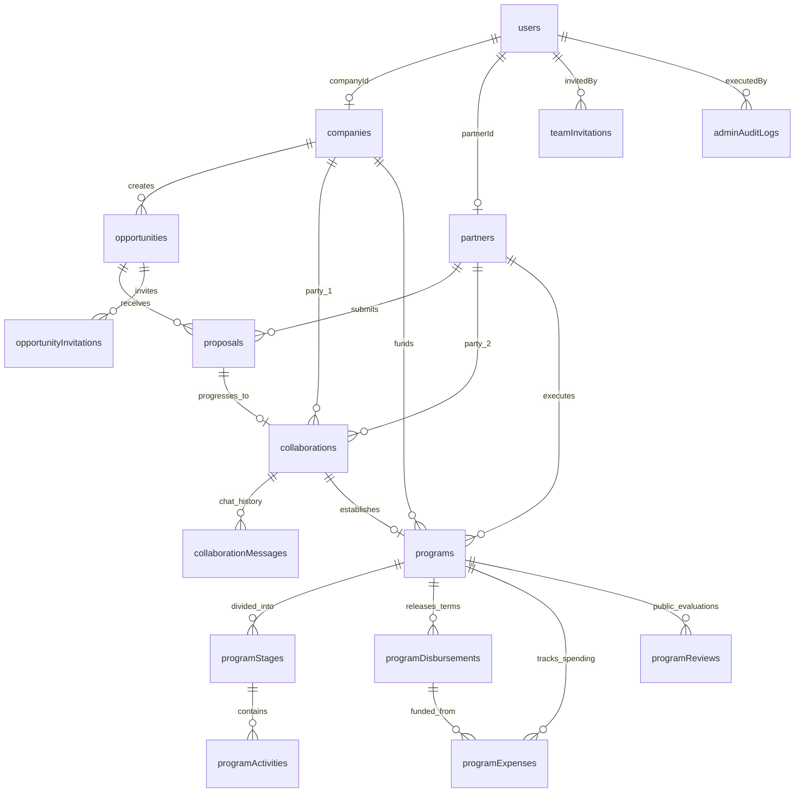

# 🗄️ Database Schema & Data Dictionary — Project CSR (Sipena)

Dokumentasi ini menjelaskan skema basis data relasional MySQL yang dikelola menggunakan **Drizzle ORM**, mencakup Entity-Relationship Diagram (ERD), kamus data 16 tabel, enum status, dan konvensi query.

---

## 1. Entity-Relationship Diagram (ERD)

---

## 2. Kamus Data Master Enum (*Global Enums*)

Seluruh enum didefinisikan secara type-safe di `src/db/schema/`:

### A. Role Pengguna (`src/db/schema/users.ts`)
| Enum Value | Deskripsi |
| :--- | :--- |
| `SUPER_ADMIN` | Pengelola platform tingkat global (*platform-wide*) untuk verifikasi organisasi, moderasi peluang, audit program, dan tata kelola user (`companyId` dan `partnerId` wajib `null`). |
| `CSR_ADMIN` | Staf operasional CSR perusahaan. |
| `MANAGEMENT` | Pimpinan/Direksi eksekutif perusahaan sponsor. |
| `PARTNER_ADMIN` | Pengelola yayasan/organisasi nirlaba/mitra pelaksana. |
| `STAGING` | Akun baru terdaftar (belum memilih atau terhubung ke organisasi). |

### B. Bidang Fokus CSR (`src/db/schema/csr-focus-areas.ts`)
| Enum Value | Label Tampilan | Keterangan SDG / Pilar CSR |
| :--- | :--- | :--- |
| `LINGKUNGAN` | Lingkungan & Energi Hijau | SDG 13, 14, 15: Climate Action & Life On Land/Water |
| `PENDIDIKAN` | Pendidikan Berkualitas | SDG 4: Quality Education |
| `KESEHATAN` | Kesehatan & Kesejahteraan | SDG 3: Good Health and Well-being |
| `PEMBERDAYAAN_EKONOMI` | Pemberdayaan Ekonomi & UMKM | SDG 8: Decent Work and Economic Growth |
| `INFRASTRUKTUR_SOSIAL` | Sarana & Infrastruktur Sosial | SDG 9: Industry, Innovation, and Infrastructure |
| `TANGGAP_BENCANA` | Tanggap Darurat & Bencana | Bantuan logistik & rehabilitasi bencana |
| `LAINNYA` | Inisiatif Keberlanjutan Lainnya | Kategori program umum |

### C. Target Sasaran Audit Admin (`src/db/schema/admin-audit-logs.ts`)
| Enum Value | Keterangan Entitas |
| :--- | :--- |
| `COMPANY` | Perusahaan sponsor (`companies`). |
| `PARTNER` | Mitra pelaksana / NGO (`partners`). |
| `USER` | Akun pengguna sistem (`users`), termasuk pembuatan `SUPER_ADMIN`. |
| `OPPORTUNITY` | Peluang CSR yang dimoderasi (`opportunities`). |
| `PROGRAM` | Program CSR (`programs`). |
| `SYSTEM` | Operasi tata kelola tingkat sistem. |

---

## 3. Rincian Tabel Database (`src/db/schema/`)

### 1. `users` - Data Pengguna Sistem
Menyimpan kredensial autentikasi pengguna dan pemetaan ke organisasi. Dilengkapi SQL Check Constraint `chk_user_company_or_partner` (`company_id IS NULL OR partner_id IS NULL`); akun `SUPER_ADMIN` dan `STAGING` memiliki keduanya bernilai `NULL`.
- `id` (VARCHAR(36), PK): UUID unik.
- `companyId` (VARCHAR(36), FK $\rightarrow$ `companies.id`, NULLABLE): ID perusahaan (jika role CSR).
- `partnerId` (VARCHAR(36), FK $\rightarrow$ `partners.id`, NULLABLE): ID mitra (jika role mitra).
- `name` (VARCHAR(150), NOT NULL): Nama lengkap pengguna.
- `email` (VARCHAR(255), NOT NULL, UNIQUE): Email untuk login.
- `password` (VARCHAR(255), NOT NULL): Password hash (Bcrypt).
- `role` (ENUM `'SUPER_ADMIN' | 'CSR_ADMIN' | 'MANAGEMENT' | 'PARTNER_ADMIN' | 'STAGING'`, NOT NULL, DEFAULT `'STAGING'`): Role RBAC pengguna.
- `status` (ENUM `'ACTIVE' | 'INACTIVE' | 'SUSPENDED'`, NOT NULL, DEFAULT `'ACTIVE'`): Status aktif pengguna.
- `avatarUrl` (TEXT, NULLABLE): URL foto profil.
- `phone` (VARCHAR(30), NULLABLE): Nomor telepon kontak.
- `position` (VARCHAR(100), NULLABLE): Jabatan di organisasi/platform.
- `createdAt`, `updatedAt` (TIMESTAMP).

### 2. `companies` - Profil Perusahaan Sponsor
- `id` (VARCHAR(36), PK): UUID unik perusahaan.
- `name` (VARCHAR(150), NOT NULL): Nama resmi perseroan.
- `tagline`, `description`, `csrVision` (VARCHAR/TEXT, NULLABLE): Deskripsi & visi CSR perusahaan.
- `industry`, `companySize`, `foundedYear` (VARCHAR/INT, NULLABLE): Sektor industri, skala, dan tahun berdiri.
- `email`, `phone` (VARCHAR, NULLABLE): Kontak korporat.
- `address`, `city`, `province` (TEXT/VARCHAR, NULLABLE): Domisili kantor pusat.
- `website`, `logoUrl`, `coverUrl`, `instagramUrl`, `linkedinUrl` (VARCHAR/TEXT, NULLABLE): Identitas & tautan korporat.
- `nibNumber`, `npwpNumber`, `sustainabilityReportUrl` (VARCHAR/TEXT, NULLABLE): Dokumen legalitas & laporan keberlanjutan.
- `csrLeaders` (TEXT, NULLABLE): Serialisasi JSON daftar pimpinan/PIC CSR.
- `status` (ENUM `'ACTIVE' | 'INACTIVE' | 'SUSPENDED'`, NOT NULL, DEFAULT `'ACTIVE'`).
- `isVerified` (BOOLEAN, NOT NULL, DEFAULT `false`): Status verifikasi legalitas resmi oleh Super Admin.
- `verifiedAt` (TIMESTAMP, NULLABLE): Waktu verifikasi legalitas disetujui.
- `verifiedBy` (VARCHAR(36), NULLABLE): UUID akun `SUPER_ADMIN` pemverifikasi (tanpa inline FK untuk menghindari circular reference dengan `users.ts`).
- `verificationNotes` (TEXT, NULLABLE): Catatan hasil telaah dokumen atau alasan suspensi.
- `createdAt`, `updatedAt` (TIMESTAMP).

### 3. `partners` - Profil Mitra Pelaksana / Lembaga NGO
- `id` (VARCHAR(36), PK): UUID unik lembaga mitra.
- `name` (VARCHAR(150), NOT NULL): Nama yayasan/komunitas.
- `tagline`, `description` (VARCHAR/TEXT, NULLABLE): Profil lembaga.
- `email`, `phone`, `address`, `city`, `province` (VARCHAR/TEXT, NULLABLE): Kontak & domisili.
- `website`, `logoUrl`, `coverUrl` (VARCHAR/TEXT, NULLABLE): Branding lembaga.
- `organizationType` (VARCHAR(100), NULLABLE): Jenis lembaga (misal: `"Yayasan"`, `"Perkumpulan / NGO"`, `"Komunitas Sosial"`).
- `foundedYear`, `legalNumber`, `npwpNumber` (INT, VARCHAR): Tahun berdiri dan bukti legalitas Kemenkumham/Dinsos & NPWP.
- `instagramUrl`, `linkedinUrl`, `youtubeUrl`, `portfolioDocUrl` (VARCHAR, NULLABLE): Tautan sosial & berkas portofolio PDF.
- `pastActivities`, `teamMembers` (TEXT, NULLABLE): Serialisasi JSON portofolio kegiatan & struktur tim.
- `focusArea` (ENUM `csrFocusAreaEnum`, NOT NULL, DEFAULT `'LAINNYA'`): Fokus utama lembaga.
- `status` (ENUM `'ACTIVE' | 'INACTIVE' | 'SUSPENDED'`, NOT NULL, DEFAULT `'ACTIVE'`).
- `isVerified` (BOOLEAN, NOT NULL, DEFAULT `false`): Status verifikasi legalitas resmi oleh Super Admin.
- `verifiedAt` (TIMESTAMP, NULLABLE): Waktu verifikasi legalitas disetujui.
- `verifiedBy` (VARCHAR(36), NULLABLE): UUID akun `SUPER_ADMIN` pemverifikasi (tanpa inline FK untuk menghindari circular reference dengan `users.ts`).
- `verificationNotes` (TEXT, NULLABLE): Catatan pemeriksaan dokumen atau alasan suspensi.
- `createdAt`, `updatedAt` (TIMESTAMP).

### 4. `team_invitations` — Undangan Bergabung Anggota Tim
- `id` (VARCHAR(36), PK): UUID undangan.
- `email` (VARCHAR(255), NOT NULL): Email rekan yang diundang.
- `role` (ENUM, NOT NULL): Role yang akan diberikan setelah klaim.
- `companyId`, `partnerId` (VARCHAR(36), NULLABLE): Organisasi target.
- `token` (VARCHAR(255), NOT NULL, UNIQUE): Token rahasia undangan.
- `expiresAt` (TIMESTAMP, NOT NULL): Waktu kedaluwarsa token (misal: 7 hari).
- `status` (ENUM: `'PENDING'`, `'ACCEPTED'`, `'EXPIRED'`, `'CANCELLED'`).
- `invitedBy` (VARCHAR(36), FK $\rightarrow$ `users.id`).

### 5. `opportunities` — Inisiatif & Peluang CSR Terbuka
- `id` (VARCHAR(36), PK): UUID inisiatif.
- `companyId` (VARCHAR(36), FK $\rightarrow$ `companies.id`, NOT NULL): Perusahaan penyelenggara.
- `title` (VARCHAR(255), NOT NULL): Nama inisiatif program CSR.
- `description` (TEXT, NOT NULL): Panduan kriteria dan latar belakang inisiatif.
- `focusArea` (ENUM `csrFocusAreaEnum`, NOT NULL): Pilar pilar CSR / SDG.
- `targetBeneficiaries` (VARCHAR(255), NULLABLE): Target sasaran penerima manfaat.
- `estimatedBudget` (DECIMAL(15,2), NOT NULL): Estimasi pagu anggaran pendanaan.
- `startDate`, `endDate` (TIMESTAMP, NULLABLE): Rencana periode pelaksanaan.
- `locationProvince`, `locationCity` (VARCHAR, NULLABLE): Lokasi geografis program.
- `status` (ENUM: `'DRAFT'`, `'OPEN'`, `'REVIEWING'`, `'IN_PROGRESS'`, `'COMPLETED'`, `'CANCELLED'`).

### 6. `opportunity_invitations` — Undangan Eksklusif Pitching Mitra
- `id` (VARCHAR(36), PK): UUID undangan.
- `opportunityId` (VARCHAR(36), FK $\rightarrow$ `opportunities.id`).
- `partnerId` (VARCHAR(36), FK $\rightarrow$ `partners.id`).
- `invitedBy` (VARCHAR(36), FK $\rightarrow$ `users.id`).
- `message` (TEXT, NULLABLE): Catatan undangan kurasi.
- `status` (ENUM: `'INVITED'`, `'ACCEPTED'`, `'DECLINED'`).

### 7. `proposals` — Proposal Masuk dari Mitra
- `id` (VARCHAR(36), PK): UUID proposal.
- `opportunityId` (VARCHAR(36), FK $\rightarrow$ `opportunities.id`, NOT NULL).
- `partnerId` (VARCHAR(36), FK $\rightarrow$ `partners.id`, NOT NULL).
- `submittedBy` (VARCHAR(36), FK $\rightarrow$ `users.id`, NOT NULL).
- `title` (VARCHAR(255), NOT NULL): Judul kegiatan yang diusulkan.
- `summary` (TEXT, NOT NULL): Ringkasan teknis & metodologi kerja.
- `proposedBudget` (DECIMAL(15,2), NOT NULL): Usulan total RAB (Rupiah).
- `durationMonths` (INT, NULLABLE): Durasi pelaksanaan dalam bulan.
- `targetBeneficiaries` (VARCHAR(255), NULLABLE): Deskripsi sasaran warga.
- `documentUrl` (TEXT, NULLABLE): Tautan berkas proposal PDF atau Google Docs.
- `feedback` (TEXT, NULLABLE): Catatan evaluasi / poin revisi dari reviewer perusahaan.
- `status` (ENUM: `'SUBMITTED'`, `'UNDER_REVIEW'`, `'REVISION_REQUESTED'`, `'ACCEPTED'`, `'REJECTED'`, `'WITHDRAWN'`).
- `reviewedBy` (VARCHAR(36), FK $\rightarrow$ `users.id`, NULLABLE): PIC peninjau.
- `reviewedAt` (TIMESTAMP, NULLABLE): Waktu peninjauan terakhir.
- `aiScore` (INT, NULLABLE): Skor kelayakan total AI (0–100).
- `aiScreeningResult` (TEXT, NULLABLE): Serialisasi JSON hasil evaluasi multi-aspek AI.
- `aiScreenedAt` (TIMESTAMP, NULLABLE): Waktu analisis AI dijalankan.

### 8. `collaborations` — Kemitraan & Perjanjian Kerjasama (MoU)
- `id` (VARCHAR(36), PK): UUID kolaborasi.
- `opportunityId` (VARCHAR(36), FK $\rightarrow$ `opportunities.id`).
- `proposalId` (VARCHAR(36), FK $\rightarrow$ `proposals.id`).
- `companyId` (VARCHAR(36), FK $\rightarrow$ `companies.id`).
- `partnerId` (VARCHAR(36), FK $\rightarrow$ `partners.id`).
- `agreementDocumentUrl` (TEXT, NULLABLE): Berkas resmi MoU/PKS yang sudah ditandatangani.
- `agreedBudget` (DECIMAL(15,2), NULLABLE): Nilai anggaran final yang disepakati.
- `startDate`, `endDate` (TIMESTAMP, NULLABLE): Jadwal resmi kemitraan.
- `status` (ENUM: `'NEGOTIATION'`, `'MOU_DRAFTING'`, `'AGREED'`, `'REJECTED'`, `'TERMINATED'`).
- `impactPrediction` (TEXT, NULLABLE): 🆕 Serialisasi JSON hasil estimasi output, proyeksi outcome, rekomendasi KPI MoU, dan risiko wilayah dari AI.
- `impactPredictedAt` (TIMESTAMP, NULLABLE): 🆕 Waktu simulasi AI dampak dijalankan.
- `finalizedBy` (VARCHAR(36), FK $\rightarrow$ `users.id`).
- `finalizedAt` (TIMESTAMP).

### 9. `collaboration_messages` — Ruang Percakapan & Negosiasi
- `id` (VARCHAR(36), PK): UUID pesan chat.
- `collaborationId` (VARCHAR(36), FK $\rightarrow$ `collaborations.id`, NOT NULL).
- `senderId` (VARCHAR(36), FK $\rightarrow$ `users.id`, NOT NULL).
- `message` (TEXT, NOT NULL): Isi teks obrolan.
- `attachmentUrl` (TEXT, NULLABLE): Berkas lampiran dalam chat.

### 10. `programs` — Proyek Eksekusi Lapangan
- `id` (VARCHAR(36), PK): UUID program aktif.
- `collaborationId` (VARCHAR(36), FK $\rightarrow$ `collaborations.id`, NOT NULL).
- `companyId` (VARCHAR(36), FK $\rightarrow$ `companies.id`, NOT NULL).
- `partnerId` (VARCHAR(36), FK $\rightarrow$ `partners.id`, NOT NULL).
- `title` (VARCHAR(255), NOT NULL): Nama program lapangan.
- `description` (TEXT, NULLABLE): Latar belakang program.
- `focusArea` (ENUM `csrFocusAreaEnum`, NOT NULL).
- `budget` (DECIMAL(15,2), NOT NULL): Komitmen pagu anggaran.
- `spentBudget` (DECIMAL(15,2), DEFAULT `'0.00'`): Total dana belanja lapangan yang terserap.
- `targetBeneficiaries` (VARCHAR(255), NULLABLE): Sasaran target warga terdampak.
- `actualBeneficiaries` (VARCHAR(255), NULLABLE): Realisasi jiwa penerima manfaat langsung.
- `startDate`, `endDate` (TIMESTAMP, NULLABLE): Tanggal kick-off & target penutupan.
- `targetCity`, `targetProvince` (VARCHAR, NULLABLE): Wilayah kerja program.
- `status` (ENUM: `'PLANNED'`, `'IN_PROGRESS'`, `'COMPLETED'`, `'ON_HOLD'`, `'CANCELLED'`).
- `sustainabilityReport` (TEXT, NULLABLE): 🆕 Serialisasi JSON hasil analisis Laporan Keberlanjutan & Dampak ESG resmi dari AI.
- `reportGeneratedAt` (TIMESTAMP, NULLABLE): 🆕 Waktu laporan ESG terakhir disusun oleh AI.

### 11. `program_stages` — Tahapan Kerja / Milestone Program
- `id` (VARCHAR(36), PK): UUID tahapan.
- `programId` (VARCHAR(36), FK $\rightarrow$ `programs.id`, NOT NULL).
- `title` (VARCHAR(255), NOT NULL): Nama tahapan kerja (misal: "Sosialisasi & Pendataan Warga").
- `description` (TEXT, NULLABLE): Sasaran output tahapan.
- `orderIndex` (INT, NOT NULL, DEFAULT 0): Urutan kronologis milestone.
- `targetDate` (TIMESTAMP, NULLABLE): Tenggat waktu target selesai.
- `completedDate` (TIMESTAMP, NULLABLE): Tanggal riil penyelesaian.
- `status` (ENUM: `'PENDING'`, `'IN_PROGRESS'`, `'COMPLETED'`).

### 12. `program_activities` — Log Aktivitas & Bukti Kegiatan Lapangan
- `id` (VARCHAR(36), PK): UUID aktivitas.
- `stageId` (VARCHAR(36), FK $\rightarrow$ `program_stages.id`, NOT NULL).
- `reportedBy` (VARCHAR(36), FK $\rightarrow$ `users.id`, NOT NULL).
- `title` (VARCHAR(255), NOT NULL): Judul kegiatan spesifik.
- `description` (TEXT, NOT NULL): Narasi laporan kemajuan.
- `activityDate` (TIMESTAMP, NOT NULL): Tanggal pelaksanaan kegiatan.
- `locationName` (VARCHAR(255), NULLABLE): Nama desa/lokasi spesifik.
- `beneficiariesCount` (INT, DEFAULT 0): Jumlah riil warga yang hadir/menerima bantuan.
- `budgetSpent` (DECIMAL(15,2), DEFAULT `'0.00'`): Biaya yang terpakai pada sesi ini.
- `photoUrl` (TEXT, NULLABLE): Dokumentasi foto lapangan.
- `status` (ENUM: `'PENDING'`, `'VERIFIED'`, `'REJECTED'`): Status validasi auditor CSR.
- `verificationNotes` (TEXT, NULLABLE): Catatan koreksi/apresiasi auditor.
- `verifiedBy` (VARCHAR(36), FK $\rightarrow$ `users.id`, NULLABLE).
- `verifiedAt` (TIMESTAMP, NULLABLE).

### 13. `program_disbursements` — Penyaluran Dana Termin Perusahaan
- `id` (VARCHAR(36), PK): UUID pencairan dana.
- `programId` (VARCHAR(36), FK $\rightarrow$ `programs.id`, NOT NULL).
- `termNumber` (INT, NOT NULL): Termin ke- (1, 2, 3, dst).
- `title` (VARCHAR(255), NOT NULL): Keterangan termin (misal: "Termin I - Uang Muka Operasional 40%").
- `amount` (DECIMAL(15,2), NOT NULL): Nominal dana yang dicairkan.
- `targetDate` (TIMESTAMP, NULLABLE): Jadwal target transfer.
- `bankName`, `accountNumber`, `accountHolderName` (VARCHAR, NULLABLE): Rekening bank tujuan mitra.
- `transferProofUrl` (TEXT, NULLABLE): Foto bukti struk transfer bank.
- `status` (ENUM: `'SCHEDULED'`, `'DISBURSED'`, `'CONFIRMED'`, `'CANCELLED'`).
- `disbursedAt`, `disbursedBy` (TIMESTAMP, VARCHAR(36)): Metadata transfer oleh perusahaan.
- `confirmedAt`, `confirmedBy` (TIMESTAMP, VARCHAR(36)): Konfirmasi penerimaan dana oleh mitra.

### 14. `program_expenses` — Laporan Akuntabilitas Belanja Mitra
- `id` (VARCHAR(36), PK): UUID nota pengeluaran.
- `programId` (VARCHAR(36), FK $\rightarrow$ `programs.id`, NOT NULL).
- `disbursementId` (VARCHAR(36), FK $\rightarrow$ `program_disbursements.id`, NULLABLE): Sumber termin dana terkait.
- `title` (VARCHAR(255), NOT NULL): Uraian belanja (misal: "Pembelian 5.000 Polybag Bibit").
- `category` (ENUM: `'LOGISTICS'`, `'MATERIALS'`, `'HONORARIUM'`, `'EQUIPMENT'`, `'OPERATIONAL'`, `'OTHER'`).
- `amount` (DECIMAL(15,2), NOT NULL): Nilai nota riil.
- `expenseDate` (TIMESTAMP, NOT NULL): Tanggal kuitansi/transaksi.
- `invoiceNumber` (VARCHAR(255), NULLABLE): Nomor kuitansi / nota toko.
- `receiptPhotoUrl` (TEXT, NULLABLE): Foto kuitansi / struk / BAST pembelian.
- `status` (ENUM: `'REPORTED'`, `'VERIFIED'`, `'REJECTED'`).
- `reportedBy` (VARCHAR(36), FK $\rightarrow$ `users.id`, NOT NULL).
- `verifiedBy` (VARCHAR(36), FK $\rightarrow$ `users.id`, NULLABLE).
- `verificationNotes` (TEXT, NULLABLE).

### 15. `program_reviews` — Survei Kepuasan Masyarakat Penerima Manfaat
- `id` (VARCHAR(36), PK): UUID ulasan publik.
- `programId` (VARCHAR(36), FK $\rightarrow$ `programs.id`, NOT NULL, ON DELETE CASCADE).
- `reviewerName` (VARCHAR(100), NOT NULL): Nama warga penerima manfaat.
- `reviewerRole` (VARCHAR(100), NOT NULL): Peran/profesi warga (misal: `"Penerima Manfaat Langsung"`, `"Tokoh Masyarakat"`).
- `reviewerCity` (VARCHAR(100), NULLABLE): Kota/wilayah responden warga.
- `rating` (INT, NOT NULL): Skor bintang (1 hingga 5).
- `comment` (TEXT, NOT NULL): Testimoni kualitatif warga.
- `sentiment` (ENUM `'POSITIVE' | 'NEUTRAL' | 'NEGATIVE'`, NULLABLE): Klasifikasi sentimen hasil analisis AI.
- `photoUrl` (VARCHAR(500), NULLABLE): Foto warga dengan sarana bantuan.
- `ipAddress` (VARCHAR(100), NULLABLE): Hash/IP untuk rate limiting anti-spam.
- `userAgent` (VARCHAR(255), NULLABLE): Metadata browser/smartphone.
- `createdAt`, `updatedAt` (TIMESTAMP).

### 16. `admin_audit_logs` - Rekam Jejak Audit Super Admin
Menyimpan catatan mutasi administratif yang dieksekusi oleh `SUPER_ADMIN` demi transparansi dan tata kelola platform.
- `id` (VARCHAR(36), PK): UUID unik log audit.
- `adminId` (VARCHAR(36), FK $\rightarrow$ `users.id`, NOT NULL): ID akun Super Admin eksekutor aksi.
- `action` (VARCHAR(100), NOT NULL): Jenis aksi (misal: `VERIFY_COMPANY`, `REVOKE_COMPANY_VERIFICATION`, `UPDATE_COMPANY_STATUS`, `VERIFY_PARTNER`, `UPDATE_PARTNER_STATUS`, `CREATE_SUPER_ADMIN`, `UPDATE_USER_STATUS`, `SUSPEND_USER`, `FORCE_CLOSE_OPPORTUNITY`, `REOPEN_OPPORTUNITY`).
- `targetType` (ENUM `'COMPANY' | 'PARTNER' | 'USER' | 'OPPORTUNITY' | 'PROGRAM' | 'SYSTEM'`, NOT NULL): Kategori entitas sasaran.
- `targetId` (VARCHAR(36), NOT NULL): UUID entitas yang dimodifikasi.
- `targetLabel` (VARCHAR(255), NULLABLE): Label/nama entitas saat aksi dilakukan agar mudah dibaca.
- `previousValue` (TEXT, NULLABLE): Serialisasi JSON status/nilai sebelum perubahan.
- `newValue` (TEXT, NULLABLE): Serialisasi JSON status/nilai setelah perubahan.
- `reason` (TEXT, NULLABLE): Catatan verifikasi, alasan penangguhan, atau dasar moderasi.
- `createdAt` (TIMESTAMP, DEFAULT NOW(), NOT NULL): Waktu eksekusi aksi.

---

## 4. Konvensi Query & Transaksi Drizzle ORM

1. **Gunakan Transaksi untuk Operasi Multi-Tabel**:
   Ketika persetujuan proposal (`proposals`) secara otomatis melahirkan `collaborations`, gunakan `db.transaction(async (tx) => { ... })` agar data tetap konsisten bila terjadi kendala jaringan.
2. **Kalkulasi Desimal Keuangan**:
   Kolom uang (`proposedBudget`, `totalBudget`, `amount`) disimpan sebagai `DECIMAL(15,2)` di MySQL dan dibaca sebagai string berpresisi tinggi di TypeScript. Konversikan ke kalkulasi numerik secara aman atau format menggunakan helper `formatRupiah(val)`.
