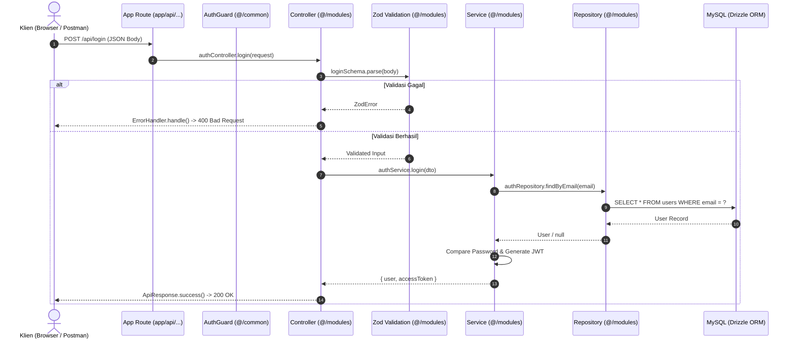

# Dokumentasi Struktur Folder & Arsitektur - Project CSR

Dokumentasi ini menjelaskan arsitektur folder, prinsip desain modular, dan pembagian tanggung jawab (*separation of concerns*) pada proyek **CSR Impact Hub**.

---

## 1. Prinsip Arsitektur Proyek

Proyek ini dibangun menggunakan **Next.js 16 (App Router)** dengan kombinasi pola **Modular 3-Tier Layered Architecture** (Controller, Service, Repository) di sisi backend, serta **Shadcn-Style Modular Components** di sisi frontend:

- **Modular & Feature-Based (`src/modules`):** Setiap fitur bisnis dibungkus dalam satu modul mandiri yang mengelola validasi, logika bisnis, query database, dan kontroler.
- **Cross-Cutting Concerns (`src/common`):** Fungsi utilitas, error handling kustom, logger, JWT, dan RBAC guard dikonsentrasikan di folder bersama agar reusable di seluruh modul.
- **Reusable UI Primitives (`src/components/ui`):** Komponen antarmuka atomik yang independen dan dapat digunakan ulang di seluruh halaman.
- **Database As Code (`src/db` & `drizzle`):** Definisi skema tabel MySQL dikelola dengan Drizzle ORM secara *type-safe* dan terlacak riwayat migrasinya.

---

## 2. Struktur Pohon Direktori (*Directory Tree*)

```text
project-csr/
├── app/                          # Next.js App Router (Halaman, Layout, & Route Handlers)
│   ├── api/                      # Backend API Endpoints (Next.js Route Handlers)
│   │   ├── auth/                 # Endpoint autentikasi spesifik
│   │   │   ├── login/route.ts    # POST /api/auth/login
│   │   │   ├── register/route.ts # POST /api/auth/register
│   │   │   └── me/route.ts       # GET /api/auth/me (Protected Bearer Token)
│   │   ├── login/route.ts        # POST /api/login (Route alias)
│   │   ├── register/route.ts     # POST /api/register (Route alias)
│   │   └── test/route.ts         # GET /api/test (Contoh RBAC CSR_ADMIN)
│   ├── dashboard/                # Halaman Dashboard
│   │   └── page.tsx              # /dashboard (Halaman pengujian sesi login)
│   ├── login/                    # Halaman Autentikasi Login
│   │   └── page.tsx              # /login (Tampilan Split-Screen Login)
│   ├── register/                 # Halaman Autentikasi Register
│   │   └── page.tsx              # /register (Tampilan Split-Screen Register)
│   ├── globals.css               # Konfigurasi Tailwind CSS v4 & Brand Token
│   ├── layout.tsx                # Root layout HTML, font Plus Jakarta Sans, Metadata
│   └── page.tsx                  # Landing Page utama (/)
│
├── docs/                         # Dokumentasi Teknis Proyek
│   ├── api-documentation.md      # Spesifikasi REST API, kontrak payload, status code
│   ├── design-system.md          # Spesifikasi warna Emerald & Slate, tipografi, UI tokens
│   ├── folder-structure.md       # Dokumentasi arsitektur & struktur folder (file ini)
│   └── postman_collection.json   # Koleksi Postman siap import dengan auto-token test
│
├── drizzle/                      # File Hasil Migrasi SQL (Drizzle Kit)
│   ├── 20261009144450_.../       # Migrasi awal skema tabel (companies, partners, users)
│   └── 20261010015914_.../       # Migrasi penambahan kolom password
│
├── public/                       # Aset statis publik (SVG logo, icon, gambar)
│
├── src/                          # Sumber Kode Inti Aplikasi
│   ├── common/                   # Shared Utilities & Cross-Cutting Concerns
│   │   ├── errors/               # Custom AppError classes
│   │   │   └── app-error.ts      # UnauthorizedError, ForBiddenError, ConflictError, dll.
│   │   ├── guards/               # Otentikasi & RBAC Middleware Helper
│   │   │   └── auth.guard.ts     # AuthGuard (authenticate & authorize)
│   │   ├── jwt/                  # Pengelolaan Token JWT
│   │   │   ├── jwt.interface.ts  # Interface JwtUserPayload
│   │   │   └── jwt.service.ts    # JwtService (sign & verify token)
│   │   ├── logger/               # Sistem Logging Terstruktur
│   │   │   ├── app-logger.ts     # Implementasi AppLogger dengan pewarnaan level
│   │   │   ├── logger.interface.ts # Interface ILogger
│   │   │   └── index.ts
│   │   ├── utils/                # Fungsi Utilitas Umum
│   │   │   ├── api-response.ts   # Format standard ApiResponse (success, created, dll)
│   │   │   ├── error-handler.ts  # Global ErrorHandler (tangani Zod, AppError, SyntaxError)
│   │   │   └── password.ts       # PasswordUtil (hashing & compare via bcryptjs)
│   │   └── index.ts              # Barrel export seluruh komponen common
│   │
│   ├── components/               # Komponen Antarmuka React (Frontend)
│   │   ├── auth/                 # Komponen Spesifik Modul Autentikasi
│   │   │   ├── auth-layout.tsx   # Split-Screen Layout (Branding panel + Form container)
│   │   │   ├── login-form.tsx    # Interactive client-side Login Form
│   │   │   ├── register-form.tsx # Interactive client-side Register Form
│   │   │   └── index.ts
│   │   └── ui/                   # Reusable UI Primitives (Shadcn-Style)
│   │       ├── badge.tsx         # Status pill & badge kategori SDG
│   │       ├── button.tsx        # Button serbaguna (varian, ukuran, loading spinner)
│   │       ├── card.tsx          # Card container (Header, Title, Content, Footer)
│   │       ├── input.tsx         # Text input dengan label, icon, & error helper
│   │       ├── password-input.tsx # Password input dengan toggle icon mata (Eye/EyeOff)
│   │       └── index.ts
│   │
│   ├── db/                       # Konfigurasi Database & ORM
│   │   ├── schema/               # Definisi Tabel MySQL (Drizzle ORM)
│   │   │   ├── companies.ts      # Skema tabel companies
│   │   │   ├── partners.ts       # Skema tabel partners
│   │   │   ├── users.ts          # Skema tabel users (role, mutual exclusivity check)
│   │   │   └── index.ts          # Re-export semua skema tabel
│   │   └── index.ts              # Inisialisasi pool MySQL2 & Drizzle client
│   │
│   └── modules/                  # Modul Fitur Bisnis (Domain-Driven 3-Tier Layer)
│       └── auth/                 # Modul Autentikasi & Akun
│           ├── auth.controller.ts# Menangani HTTP request/response & integrasi ErrorHandler
│           ├── auth.interface.ts # Tipe data & DTO (RegisterDTO, LoginDTO, SafeUser)
│           ├── auth.repository.ts# Layer database query (findByEmail, findById, createUser)
│           ├── auth.service.ts   # Logika bisnis inti (hashing, verifikasi kredensial, JWT)
│           ├── auth.validation.ts# Skema validasi request berbasis Zod (registerSchema, loginSchema)
│           └── index.ts          # Ekspor instansiasi singleton service & controller
│
├── .env                          # Variabel lingkungan lokal (Database URL, JWT Secret)
├── drizzle.config.ts             # Konfigurasi Drizzle Kit (dialect MySQL, schema path)
├── next.config.ts                # Konfigurasi Next.js 16 (Turbopack, cache components)
├── package.json                  # Manajemen dependensi & skrip npm
└── tsconfig.json                 # Konfigurasi TypeScript & path aliases (@/*)
```

---

## 3. Pembagian Tanggung Jawab (*Separation of Responsibilities*)

### A. Lapisan Backend (`src/modules/*`):
Setiap modul bisnis mengikuti pola 3-Tier:
1. **Controller (`*.controller.ts`):** 
   - Menerima request HTTP.
   - Menjalankan validasi input Zod.
   - Memanggil service yang sesuai.
   - Membungkus respon dengan `ApiResponse` dan menangkap kegagalan dengan `ErrorHandler`.
2. **Service (`*.service.ts`):**
   - Berisi aturan bisnis (*business logic*), seperti: verifikasi password hash, penolakan email duplikat, penerbitan token JWT, atau penetapan role default `STAGING`.
   - Tidak tergantung langsung pada objek HTTP Request/Response Next.js.
3. **Repository (`*.repository.ts`):**
   - Berisi operasi query langsung ke database menggunakan Drizzle ORM (`select`, `insert`, `update`, `delete`).
4. **Validation (`*.validation.ts`):**
   - Skema validasi Zod untuk memastikan payload klien valid sebelum diproses lebih lanjut.

---

### B. Lapisan Routing (`app/`):
- **`app/api/*`:** Berfungsi sebagai *gateway* tipis (*thin route handlers*). File `route.ts` hanya bertugas meneruskan `request` ke controller modul yang bersangkutan (misal: `authController.login(request)`).
- **`app/(pages)/*`:** Menggunakan React Server Components secara default, dan memanggil Client Components interaktif dari `src/components/*` jika membutuhkan interaksi state.

---

### C. Lapisan Komponen Antarmuka (`src/components/*`):
- **`src/components/ui/*`:** Komponen atomik (*primitives*) bebas dependensi bisnis (seperti Button, Input, Card, Badge). Komponen ini aman digunakan di halaman manapun.
- **`src/components/[domain]/*`:** Komponen yang memiliki konteks domain tertentu (misalnya `auth-layout.tsx` atau `login-form.tsx`).

---

## 4. Alur Siklus Permintaan (*Request Lifecycle Flow*)

Berikut diagram alur kerja saat sebuah permintaan API dieksekusi:



---

## 5. Panduan Menambah Modul Fitur Baru

Jika Anda ingin menambahkan modul baru (misalnya **Proyek CSR** / `projects` atau **Kemitraan** / `partners`), ikuti pola baku berikut:

1. **Definisikan Skema Database:**
   - Tambahkan tabel di `src/db/schema/[nama_tabel].ts`.
   - Re-export di `src/db/schema/index.ts`.
   - Jalankan `npm run db:generate` dan `npm run db:migrate`.
2. **Buat Folder Modul di `src/modules/[nama_fitur]/`:**
   - `[fitur].interface.ts` (DTO & Types)
   - `[fitur].validation.ts` (Skema Zod)
   - `[fitur].repository.ts` (Drizzle queries)
   - `[fitur].service.ts` (Logika bisnis)
   - `[fitur].controller.ts` (Handler HTTP)
   - `index.ts` (Instansiasi singleton & export)
3. **Daftarkan Route Handler di `app/api/[nama_fitur]/route.ts`:**
   - Panggil controller terkait dan proteksi dengan `AuthGuard.authorize(request, [ROLES])` jika memerlukan otorisasi RBAC.
