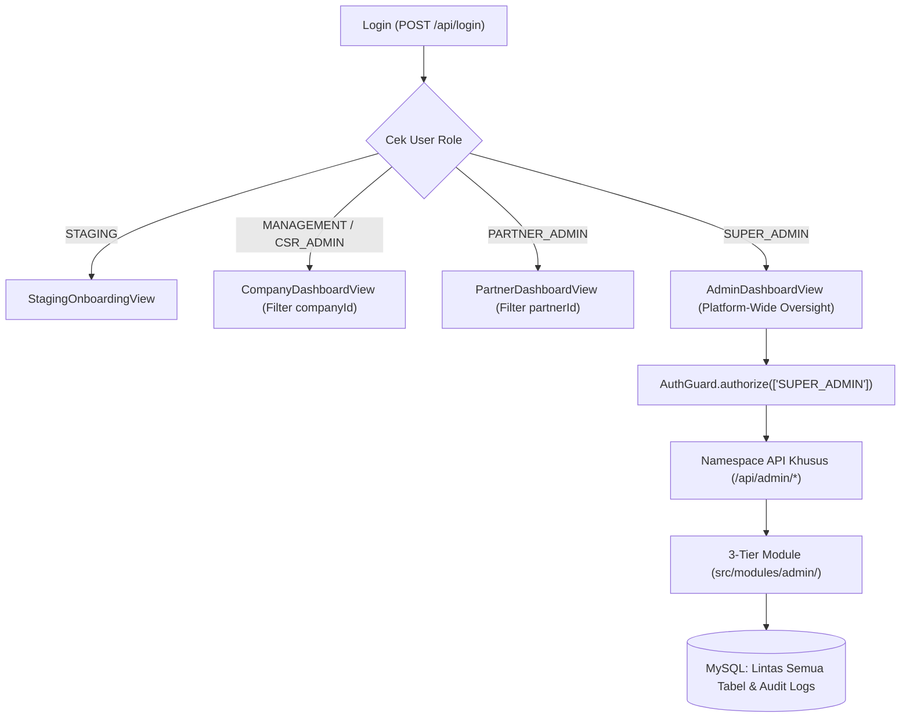

# Spesifikasi Fitur & Arsitektur: Role Super Admin (Platform Oversight)

Dokumen ini menjadi cetak biru teknis dan produk (*blueprint*) untuk pengembangan role **`SUPER_ADMIN`** pada platform **SIPENA (Project CSR)**. Seluruh implementasi database, backend 3-tier, kontrak API, keamanan RBAC, serta antarmuka frontend wajib mengacu pada dokumen ini agar konsisten dengan arsitektur utama proyek.

---

## 1. Latar Belakang & Prinsip Desain

### Peran Super Admin dalam Ekosistem Multi-Tenant SIPENA
Platform SIPENA menghubungkan **Perusahaan Sponsor (`MANAGEMENT`, `CSR_ADMIN`)**, **Mitra Pelaksana / NGO (`PARTNER_ADMIN`)**, dan **Penerima Manfaat Publik**. Hingga saat ini seluruh kontrol terisolasi di masing-masing tenant melalui relasi `companyId` dan `partnerId`.

Role **`SUPER_ADMIN`** hadir di level **platform-wide** (di atas seluruh tenant) dengan fungsi utama mengawasi ekosistem, memverifikasi kelayakan legalitas organisasi, memoderasi konten publik, menjaga akuntabilitas program dan dana, serta mengelola akses pengguna secara terpusat.

### Prinsip Tata Kelola (*Governance Principles*)
1. **Platform-Wide Visibility tanpa Kepemilikan Tenant**: Akun `SUPER_ADMIN` tidak terikat ke perusahaan atau mitra mana pun (`companyId = null`, `partnerId = null`), dan tetap mematuhi SQL constraint `chk_user_company_or_partner` pada tabel `users`.
2. **Read-Only Audit + Moderation Status Control**: Untuk menjaga integritas audit keuangan dan laporan lapangan antar-pihak, Super Admin beroperasi dalam mode **Read-Only Audit** terhadap nominal realisasi dana, nota pengeluaran, maupun laporan aktivitas program, namun memiliki kewenangan penuh melakukan **Kontrol Status & Moderasi** (`ACTIVE`, `INACTIVE`, `SUSPENDED`, dan penutupan paksa peluang bermasalah ke `CLOSED`).
3. **Zero Public Self-Registration**: Role `SUPER_ADMIN` tidak dapat dipilih atau dibuat melalui halaman pendaftaran publik (`/register` atau `POST /api/register`). Akun perdana dibuat melalui CLI Seeder dan penambahan berikutnya dilakukan secara internal oleh Super Admin aktif.

---

## 2. Diagram Alur & Posisi Arsitektur



---

## 3. Spesifikasi Basis Data (`src/db/schema/`)

### 3.1 Pembaruan Enum Role (`src/db/schema/users.ts`)
Tambahkan `"SUPER_ADMIN"` ke dalam [`userRoleEnum`](file:///c:/Users/Pongo/Documents/projects/next.js/project-csr/src/db/schema/users.ts):

```typescript
export const userRoleEnum = [
  "SUPER_ADMIN",
  "CSR_ADMIN",
  "MANAGEMENT",
  "PARTNER_ADMIN",
  "STAGING",
] as const;
```

### 3.2 Status Organisasi & Verifikasi Legalitas (`companies.ts` & `partners.ts`)
Saat ini kedua tabel sudah memiliki kolom `status` (`"ACTIVE" | "INACTIVE" | "SUSPENDED"`):
- Organisasi baru tetap berstatus default **`ACTIVE`** setelah onboarding agar alur kerja perusahaan/mitra tidak terhambat saat mulai memakai platform.
- Untuk membedakan organisasi yang legalitasnya sudah diperiksa secara resmi oleh tim pengelola platform, ditambahkan kolom verifikasi ringan (opsional namun direkomendasikan) pada `companies` dan `partners`:
  - `isVerified`: `boolean().notNull().default(false)`
  - `verifiedAt`: `timestamp()` (nullable)
  - `verifiedBy`: `varchar("verified_by", { length: 36 }).references(() => users.id)` (nullable)
  - `verificationNotes`: `text()` (nullable, dapat mencatat alasan verifikasi atau alasan suspensi)

### 3.3 Tabel Audit Trail Admin (`src/db/schema/admin-audit-logs.ts`)
Menyimpan riwayat seluruh aksi sensitif yang dilakukan Super Admin demi akuntabilitas tata kelola platform:

| Kolom | Tipe Data | Keterangan |
| :--- | :--- | :--- |
| `id` | `VARCHAR(36)` (PK) | UUID unik log aktivitas |
| `adminId` | `VARCHAR(36)` (FK -> `users.id`) | ID akun Super Admin yang mengeksekusi aksi |
| `action` | `VARCHAR(100)` | Jenis aksi (misal: `UPDATE_COMPANY_STATUS`, `VERIFY_PARTNER`, `SUSPEND_USER`, `MODERATE_OPPORTUNITY`, `CREATE_SUPER_ADMIN`) |
| `targetType` | `ENUM("COMPANY", "PARTNER", "USER", "OPPORTUNITY", "PROGRAM", "SYSTEM")` | Kategori entitas sasaran |
| `targetId` | `VARCHAR(36)` | ID entitas sasaran |
| `targetLabel` | `VARCHAR(255)` | Nama/judul entitas saat aksi terjadi (memudahkan pembacaan log) |
| `previousValue` | `TEXT` | Ringkasan/JSON nilai sebelum perubahan |
| `newValue` | `TEXT` | Ringkasan/JSON nilai setelah perubahan |
| `reason` | `TEXT` | Catatan atau alasan administratif dari Super Admin |
| `createdAt` | `TIMESTAMP` | Waktu aksi dieksekusi |

> **Aturan Migrasi Drizzle**: Setiap penambahan atau perubahan skema di `src/db/schema/` wajib didaftarkan di `src/db/schema/index.ts`, diikuti `npm run db:generate` dan `npm run db:migrate` (atau `npm run db:push` bila perlu sinkronisasi pengembangan lokal).

---

## 4. Rancangan Backend 3-Tier (`src/modules/admin/`)

Mengikuti pola arsitektur SIPENA, seluruh logika bisnis Super Admin diisolasi di folder `src/modules/admin/`:

```text
src/modules/admin/
├── admin.interface.ts     # DTO, query pagination, response overview & audit
├── admin.validation.ts    # Zod schema untuk validasi input moderasi & pembuatan admin
├── admin.repository.ts    # Query agregasi lintas tenant, join detail, & insert audit log
├── admin.service.ts       # Aturan bisnis, proteksi anti-self-lockout, hashing password
├── admin.controller.ts    # Autentikasi, AuthGuard ['SUPER_ADMIN'], ErrorHandler, ApiResponse
└── index.ts               # Export singleton / factory modul
```

### Aturan Keamanan & Validasi Wajib di `AdminService`
1. **Strict Role Enforcement**: Seluruh method di `AdminController` wajib memanggil `AuthGuard.authorize(request, ["SUPER_ADMIN"])`.
2. **Anti-Self-Lockout**: Super Admin **tidak boleh** mengubah status akunnya sendiri (`targetUserId === authUser.sub`) menjadi `SUSPENDED` atau `INACTIVE`.
3. **Last Active Admin Protection**: Sistem wajib menolak penonaktifan/suspensi akun `SUPER_ADMIN` apabila hanya tersisa 1 akun `SUPER_ADMIN` berstatus `ACTIVE` di database.
4. **Onboarding Guardrails**: Endpoint pembuatan organisasi ([`CompanyController.create`](file:///c:/Users/Pongo/Documents/projects/next.js/project-csr/src/modules/companies/company.controller.ts), [`PartnerController.create`](file:///c:/Users/Pongo/Documents/projects/next.js/project-csr/src/modules/partners/partner.controller.ts)) dan penerimaan undangan tim tetap hanya mengizinkan role `["STAGING"]`, sehingga Super Admin tidak dapat dialihkan ke tenant tertentu.
5. **Audit Logging Otomatis**: Setiap operasi mutasi (`PATCH`/`POST`) yang berhasil di `AdminService` otomatis menuliskan baris baru pada `admin_audit_logs`.

---

## 5. Kontrak REST API (`app/api/admin/`)

Seluruh endpoint di bawah ini wajib menyertakan header `Authorization: Bearer <TOKEN>` milik user dengan role `SUPER_ADMIN`.

### A. Ringkasan Eksekutif
| Method | Endpoint | Deskripsi |
| :--- | :--- | :--- |
| `GET` | `/api/admin/overview` | Mengambil KPI makro ekosistem, tren bulanan (6 bulan terakhir), distribusi fokus area CSR, funnel konversi kolaborasi, serta daftar antrean perhatian (*unverified orgs*, program `ON_HOLD`, dll.). |

### B. Manajemen Perusahaan & Mitra (Tenant Oversight)
| Method | Endpoint | Deskripsi |
| :--- | :--- | :--- |
| `GET` | `/api/admin/companies` | Daftar seluruh perusahaan beserta metrik ringkas (jumlah member, peluang, program, dan status verifikasi). Mendukung query `page`, `limit`, `search`, `status`, `isVerified`. |
| `GET` | `/api/admin/companies/[id]` | Detail lengkap perusahaan: profil, dokumen legalitas (`nibNumber`, `npwpNumber`, `sustainabilityReportUrl`), daftar user/anggota, peluang, dan program. |
| `PATCH` | `/api/admin/companies/[id]/status` | Mengubah `status` (`ACTIVE`/`INACTIVE`/`SUSPENDED`) dan/atau status verifikasi (`isVerified`), dilengkapi `reason`/`verificationNotes`. |
| `GET` | `/api/admin/partners` | Daftar seluruh mitra NGO/yayasan beserta metrik ringkas. Mendukung query `page`, `limit`, `search`, `status`, `focusArea`, `isVerified`. |
| `GET` | `/api/admin/partners/[id]` | Detail lengkap mitra: profil, nomor legalitas (`legalNumber`, `npwpNumber`), portofolio (`portfolioDocUrl`), rekam jejak, proposal, dan program. |
| `PATCH` | `/api/admin/partners/[id]/status` | Mengubah `status` (`ACTIVE`/`INACTIVE`/`SUSPENDED`) dan/atau `isVerified`, dilengkapi catatan. |

### C. Manajemen Pengguna Lintas Sistem
| Method | Endpoint | Deskripsi |
| :--- | :--- | :--- |
| `GET` | `/api/admin/users` | Daftar seluruh akun pengguna (`users`) lintas role beserta nama organisasi terhubung. Mendukung filter `role`, `status`, `search`, `page`, `limit`. |
| `POST` | `/api/admin/users/super-admin` | Membuat akun `SUPER_ADMIN` baru secara internal (`name`, `email`, `password`, opsional `phone`, `position`). |
| `PATCH` | `/api/admin/users/[id]/status` | Mengubah status user (`ACTIVE`/`INACTIVE`/`SUSPENDED`) disertai `reason`. Dilarang untuk akun sendiri dan Super Admin aktif terakhir. |

### D. Moderasi Peluang, Proposal, Program, & Dampak
| Method | Endpoint | Deskripsi |
| :--- | :--- | :--- |
| `GET` | `/api/admin/opportunities` | Daftar seluruh peluang CSR dari semua perusahaan dengan filter `status`, `focusArea`, `search`. |
| `PATCH` | `/api/admin/opportunities/[id]/moderate` | Aksi moderasi terhadap peluang bermasalah (misal tutup paksa status ke `CLOSED` disertai catatan alasan). |
| `GET` | `/api/admin/proposals` | Daftar seluruh proposal lintas platform (read-only), termasuk informasi perusahaan tujuan, mitra pengusul, `aiScore`, dan status review. |
| `GET` | `/api/admin/programs` | Rekap finansial platform + daftar seluruh program berjalan/selesai lintas tenant dengan filter `status`, `focusArea`, `search`. |
| `GET` | `/api/admin/programs/[id]` | Detail audit program secara read-only (identitas program, progres aktivitas & timeline, rekap termin pencairan, nota pengeluaran, dokumen MoU, laporan ESG, dan ulasan warga). |
| `GET` | `/api/admin/impact` | Agregasi dampak sosial & ulasan masyarakat (`programReviews`), distribusi rating/sentimen (`POSITIVE`, `NEUTRAL`, `NEGATIVE`), serta sebaran geografis program per kota/provinsi. |

### E. Sistem, Layanan AI & Audit Trail
| Method | Endpoint | Deskripsi |
| :--- | :--- | :--- |
| `GET` | `/api/admin/system` | Status konfigurasi fitur AI ([`isAiFeatureEnabled`](file:///c:/Users/Pongo/Documents/projects/next.js/project-csr/src/common/config/ai-feature-flag.ts)), statistik utilisasi fitur AI (proposal terscreening, program ber-laporan ESG, sentimen teranalisis), serta daftar log audit admin terbaru (`admin_audit_logs`). |

---

## 6. Struktur Antarmuka & Menu Sidebar (`src/components/dashboard/admin/`)

### Integrasi Routing Dashboard
Pada [`RoleDashboardView.tsx`](file:///c:/Users/Pongo/Documents/projects/next.js/project-csr/src/components/dashboard/RoleDashboardView.tsx):
- Jika `user.role === "SUPER_ADMIN"`, komponen langsung me-render `<AdminDashboardView user={user} onLogout={onLogout} onProfileUpdated={onProfileUpdated} />`.

### Peta Menu Sidebar (`AdminSidebar.tsx`)
Navigasi dibagi menjadi **4 grup seksi** dan **8 menu** (selaras dengan struktur `Sidebar.tsx` & `PartnerSidebar.tsx`):

| Grup Seksi | ID Menu (`AdminNavMenu`) | Label Tampilan | Ikon Lucide | Fungsi & Fokus Halaman |
| :--- | :--- | :--- | :--- | :--- |
| **UTAMA** | `overview` | Ringkasan Platform | `LayoutDashboard` | KPI ekosistem nasional, grafik tren pertumbuhan, distribusi fokus CSR, funnel konversi, dan antrean eskalasi. |
| **EKOSISTEM & PENGGUNA** | `companies` | Perusahaan Sponsor | `Building2` | Direktori perusahaan, tinjauan legalitas NIB/NPWP/laporan keberlanjutan, verifikasi resmi, serta kontrol status `ACTIVE`/`SUSPENDED`. |
| **EKOSISTEM & PENGGUNA** | `partners` | Mitra Pelaksana (NGO) | `HeartHandshake` | Direktori yayasan/NGO, pemeriksaan legalitas SK Kemenkumham/Dinsos & portofolio, verifikasi, serta kontrol status. |
| **EKOSISTEM & PENGGUNA** | `users` | Pengguna Sistem | `Users` | Manajemen user lintas role (termasuk pantau akun `STAGING`), blokir/aktifkan akun, dan modal tambah akun `SUPER_ADMIN` baru. |
| **PENGAWASAN & MODERASI** | `moderation` | Moderasi Peluang & Proposal | `ShieldAlert` | Tampilan bertab: (1) Peluang CSR Global dengan aksi *Force Close* jika melanggar, dan (2) Arus Proposal Global & Skor AI. |
| **PENGAWASAN & MODERASI** | `programs` | Pengawasan Program & Dana | `Activity` | Rekap MoU vs Termin vs Nota Pengeluaran ekosistem, daftar program lintas tenant, serta halaman detail **Read-Only Audit**. |
| **PENGAWASAN & MODERASI** | `impact` | Suara Warga & Dampak ESG | `MessageSquareHeart` | Agregasi rating & sentimen masyarakat lintas program, deteksi program berisiko sentimen negatif, dan peta sebaran wilayah. |
| **SISTEM & TATA KELOLA** | `system` | Sistem, AI & Log Audit | `ScrollText` | Status aktif fitur AI, metrik utilisasi AI, dan tabel riwayat `admin_audit_logs` beserta filter aksi/tanggal. |

> **Profil Pribadi Super Admin**: Mengikuti standar SIPENA, kartu profil pengguna di footer sidebar dan menu dropdown di [`DashboardHeader.tsx`](file:///c:/Users/Pongo/Documents/projects/next.js/project-csr/src/components/dashboard/DashboardHeader.tsx) langsung membuka [`UserProfileModal.tsx`](file:///c:/Users/Pongo/Documents/projects/next.js/project-csr/src/components/dashboard/UserProfileModal.tsx) untuk memperbarui nama, foto profil, nomor telepon, jabatan, dan kata sandi.

### Organisasi Folder Komponen Frontend
```text
src/components/dashboard/admin/
├── AdminDashboardView.tsx              # Orchestrator state, fetch data, breadcrumbs, & routing subview
├── AdminSidebar.tsx                    # Sidebar 4 grup (responsive desktop + mobile drawer)
├── types.ts                            # Definisi AdminNavMenu & tipe data response /api/admin/*
├── helpers.ts                          # Formatter status badge, rupiah, tanggal, dan label role
└── views/
    ├── AdminOverviewView.tsx           # Grafik & KPI makro platform + antrean eskalasi
    ├── AdminCompaniesView.tsx          # Tabel/kartu perusahaan + panel/halaman detail & verifikasi
    ├── AdminPartnersView.tsx           # Tabel/kartu mitra NGO + panel/halaman detail & verifikasi
    ├── AdminUsersView.tsx              # Manajemen akun pengguna & modal tambah Super Admin
    ├── AdminModerationView.tsx         # Tab Peluang CSR Global (tutup paksa) & Arus Proposal Global
    ├── AdminProgramsView.tsx           # Daftar program & rekap dana lintas tenant
    ├── AdminProgramAuditPageView.tsx   # Halaman penuh Read-Only Audit Program (timeline, keuangan, ESG, ulasan)
    ├── AdminImpactView.tsx             # Sentimen masyarakat, rating rendah, & distribusi fokus/wilayah
    └── AdminSystemAuditView.tsx        # Status AI, statistik pemakaian AI, & riwayat Admin Audit Logs
```

---

## 7. Standar Visual & Design System

Mengikuti [`design-system.md`](file:///c:/Users/Pongo/Documents/projects/next.js/project-csr/docs/design-system.md):
- **Palet Warna**:
  - Primer Eksekutif: **Corporate Slate Navy** (`#181343`) untuk heading, identitas Super Admin, dan elemen administratif.
  - Aksen Dampak: **Emerald Green** (`#059669` / `#009E75`) untuk indikator aktif/terverifikasi dan capaian positif.
  - Peringatan & Evaluasi: **Warm Amber** (`#F6AC2F` / `amber-600`) untuk entitas belum terverifikasi, `STAGING`, atau program `ON_HOLD`.
  - Penindakan / Suspensi: **Rose / Red** (`rose-600`) khusus status `SUSPENDED` atau konfirmasi tindakan blokir.
  - Permukaan (*Surface*): Latar canvas `#F9F9FB`, kartu `#FFFFFF` dengan border `#E8E8EA` dan sudut membulat `rounded-2xl` / `rounded-3xl`.
- **Aksesibilitas**: Seluruh tombol aksi dan tab interaktif menggunakan ukuran minimal tinggi sentuh `44px` (`min-h-[44px]`).
- **Konsistensi Bahasa**: Seluruh label UI, pesan error, dan placeholder memakai bahasa Indonesia institusional yang rapi tanpa istilah teknis mentah di hadapan pengguna akhir.

---

## 8. Strategi Penyediaan Akun Awal (CLI Seed Script)

Karena tidak ada opsi daftar sebagai `SUPER_ADMIN` di UI publik, akun perdana disediakan melalui script `src/db/seed-admin.ts`:
- **Perintah Eksekusi**: Menambahkan script `"db:seed:admin": "tsx src/db/seed-admin.ts"` di `package.json`.
- **Variabel Environment (`.env`)**:
  - `ADMIN_NAME` (default fallback dev: `"Super Admin SIPENA"`)
  - `ADMIN_EMAIL` (default fallback dev: `"superadmin@sipena.id"`)
  - `ADMIN_PASSWORD` (default fallback dev: dicetak aman saat seeding atau diisi wajib via `.env`)
- **Idempotency**: Script memeriksa apakah email sudah ada di tabel `users`. Jika sudah ada dan ber-role `SUPER_ADMIN`, script melewati pembuatan tanpa error; jika belum ada, password di-hash dengan `PasswordUtil.hash` dan user dibuat dengan `role: "SUPER_ADMIN"`, `status: "ACTIVE"`, `companyId: null`, `partnerId: null`.

---

## 9. Roadmap Implementasi Bertahap

1. **Fase 1 - Skema & Database**:
   - Update `src/db/schema/users.ts`, `companies.ts`, `partners.ts`.
   - Buat `src/db/schema/admin-audit-logs.ts` dan ekspor di `src/db/schema/index.ts`.
   - Generate & terapkan migrasi Drizzle (`npm run db:generate` / `db:push`).
   - Buat seeder `src/db/seed-admin.ts` + uji buat akun Super Admin perdana.
2. **Fase 2 - Backend Module & API Routes**:
   - Bangun `src/modules/admin/*` (`interface`, `validation`, `repository`, `service`, `controller`, `index`).
   - Daftarkan seluruh route handler pada `app/api/admin/**`.
   - Pastikan badge/label role di `src/modules/auth` dan komponen shared mendukung `"SUPER_ADMIN"`.
3. **Fase 3 - Shell Dashboard & Manajemen Ekosistem**:
   - Bangun `AdminSidebar.tsx`, `AdminDashboardView.tsx`, dan sambungkan di `RoleDashboardView.tsx`.
   - Implementasikan `AdminOverviewView.tsx`, `AdminCompaniesView.tsx`, `AdminPartnersView.tsx`, dan `AdminUsersView.tsx`.
4. **Fase 4 - Pengawasan Program, Moderasi, Dampak & Audit Log**:
   - Implementasikan `AdminModerationView.tsx`, `AdminProgramsView.tsx`, `AdminProgramAuditPageView.tsx`, `AdminImpactView.tsx`, dan `AdminSystemAuditView.tsx`.
5. **Fase 5 - Verifikasi & Sinkronisasi Dokumentasi**:
   - Uji `npx tsc --noEmit` dan `npm run build` hingga bebas galat.
   - Uji login Super Admin, proteksi RBAC terhadap role non-admin (harus HTTP 403), proteksi anti-self-suspend, serta pencatatan log audit.
   - Perbarui [`database-schema.md`](file:///c:/Users/Pongo/Documents/projects/next.js/project-csr/docs/database-schema.md) dan [`api-documentation.md`](file:///c:/Users/Pongo/Documents/projects/next.js/project-csr/docs/api-documentation.md) setelah implementasi selesai.

