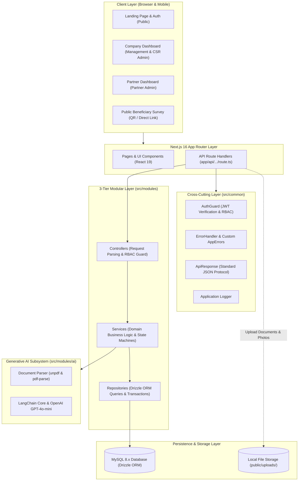
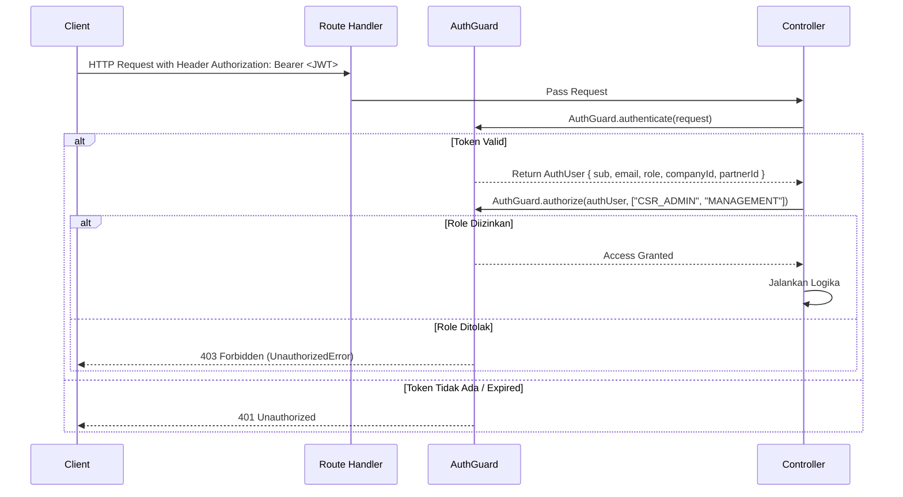

# 🏛️ System Architecture — Project CSR (Sipena)

Dokumentasi ini menjelaskan cetak biru arsitektur perangkat lunak, pola desain backend, sistem keamanan multi-tenant, dan modul kecerdasan buatan dalam **Project CSR**.

---

## 1. Diagram Arsitektur Tingkat Tinggi (High-Level Architecture)



---

## 2. Pola Arsitektur 3-Tier (*Layered Pattern*)

Setiap domain bisnis di `src/modules/` mengisolasi kode ke dalam 3 lapisan yang memiliki tanggung jawab tunggal (*Single Responsibility Principle*):

```text
src/modules/[nama_modul]/
├── [nama].controller.ts     # Lapisan 1: HTTP Presentation & Guard
├── [nama].service.ts        # Lapisan 2: Logika Bisnis & Validasi State
├── [nama].repository.ts     # Lapisan 3: Database Query via Drizzle ORM
├── [nama].interface.ts      # DTO & TypeScript Typings
├── [nama].validation.ts     # Zod Schemas
└── index.ts                 # Export modul
```

### 1. Lapisan Controller (`*.controller.ts`)
- **Tanggung Jawab**:
  - Mengekstrak data request HTTP (URL params, query string, JSON body).
  - Melakukan otentikasi via `AuthGuard.authenticate(request)`.
  - Melakukan otorisasi via `AuthGuard.authorize(authUser, [ALLOWED_ROLES])`.
  - Memvalidasi payload menggunakan skema Zod (misal: `createOpportunitySchema.parse(body)`).
  - Mengembalikan response terstandarisasi via `ApiResponse.success(...)` atau melempar error ke `ErrorHandler.handle(error)`.
- **Aturan**: Controller **TIDAK BOLEH** memuat logika database atau komputasi bisnis yang rumit.

### 2. Lapisan Service (`*.service.ts`)
- **Tanggung Jawab**:
  - Pusat seluruh aturan bisnis (*core domain logic*).
  - Memeriksa hak kepemilikan data (misal: *apakah proposal ini milik perusahaan pemanggil?*).
  - Menjalankan mesin status (*state machine* / transisi status).
  - Memanggil repository atau integrasi layanan eksternal (AI / LangChain).
- **Aturan**: Service **TIDAK BOLEH** bergantung langsung pada objek `Request` atau `NextResponse` HTTP.

### 3. Lapisan Repository (`*.repository.ts`)
- **Tanggung Jawab**:
  - Satu-satunya lapisan yang berkomunikasi langsung dengan database MySQL melalui Drizzle ORM client (`db`).
  - Menangani *joins*, filter kondisi (*where clauses*), agregasi data (*count*, *sum*, *avg*), dan transaksi database (`db.transaction`).
- **Aturan**: Repository hanya menerima dan mengembalikan data mentah bertipe murni (*plain TypeScript objects*).

---

## 3. Sistem Multi-Tenancy & Isolasi Data

Aplikasi ini menggunakan pola **Logical Multi-Tenancy** berbasis tabel tunggal dengan pemisah kunci asing (*Foreign Key Separation*):

```text
               ┌───────────────┐
               │     users     │
               └───────┬───────┘
           ┌───────────┴───────────┐
           ▼                       ▼
   companyId (Nullable)    partnerId (Nullable)
           │                       │
           ▼                       ▼
    ┌─────────────┐         ┌─────────────┐
    │  companies  │         │  partners   │
    └─────────────┘         └─────────────┘
```

### Mekanisme Isolasi:
1. **Perusahaan (Company Tenant)**:
   - Pengguna dengan role `MANAGEMENT` atau `CSR_ADMIN` memiliki kolom `companyId` yang merujuk ke tabel `companies`.
   - Seluruh inisiatif CSR (`opportunities`) yang dibuat terikat pada `companyId`.
   - Query repositori selalu menyertakan `eq(opportunities.companyId, user.companyId)` untuk memastikan perusahaan A tidak dapat melihat data privat perusahaan B.
2. **Mitra Pelaksana (Partner Tenant)**:
   - Pengguna dengan role `PARTNER_ADMIN` memiliki kolom `partnerId` yang merujuk ke tabel `partners`.
   - Proposal kemitraan (`proposals`) terikat pada `partnerId`.
   - Query repositori menyertakan `eq(proposals.partnerId, user.partnerId)`.
3. **Akun Staging**:
   - Akun baru yang baru mendaftar memiliki role `STAGING` dengan `companyId: null` dan `partnerId: null`. Pengguna diarahkan ke onboarding untuk mendirikan atau mengklaim organisasi sebelum dapat mengakses dashboard operasional.

---

## 4. Keamanan & Role-Based Access Control (RBAC)

### Matriks Otorisasi Pengguna

| Role | Deskripsi | Hak Akses Utama |
| :--- | :--- | :--- |
| **`MANAGEMENT`** | Pimpinan/Direksi Perusahaan | Memantau seluruh inisiatif, meninjau analitik ESG eksekutif, menyetujui rekomendasi proposal, finalisasi MoU & Program. |
| **`CSR_ADMIN`** | Administrator Operasional CSR | Membuat inisiatif CSR, mengevaluasi proposal, chat kemitraan, verifikasi linimasa aktivitas, konfirmasi pencairan dana. |
| **`PARTNER_ADMIN`**| Pengelola Lembaga Mitra/NGO | Mengisi profil lembaga & portofolio, mengajukan proposal, chat kemitraan, mengunggah bukti lapangan & laporan belanja, unduh QR Code survei. |
| **`STAGING`** | Pengguna Baru Terdaftar | Terbatas hanya pada halaman orientasi/onboarding untuk memilih jenis organisasi (Perusahaan atau Mitra). |
| **`PUBLIC`** | Pengunjung Umum / Warga | Akses landing page, eksplorasi peluang terbuka, dan pengisian survei ulasan dampak masyarakat (tanpa login). |

### Alur Kerja AuthGuard



---

## 5. Sub-Sistem Kecerdasan Buatan (Generative AI Engine)

Modul AI (`src/modules/ai/`) dirancang untuk mengotomatiskan dekonstruksi proposal/TOR tebal (PDF) menjadi tahapan (*stages*) dan tonggak capaian (*milestones*) terstruktur pada Program CSR.

### Komponen AI:
1. **Document Parser (`document-parser/`)**:
   - Mengekstrak teks dari berkas PDF lokal maupun remote menggunakan `unpdf` dengan fallback ke `pdf-parse`.
   - Mengabaikan header/footer redundan dan membatasi ukuran konteks agar aman terhadap batas token model.
2. **Milestone Extraction Service (`milestone-extraction/`)**:
   - Menggunakan `@langchain/openai` dengan model `gpt-4o-mini` (kecepatan tinggi, hemat biaya).
   - Menghasilkan output terstruktur dalam format JSON yang divalidasi dengan Zod schema:
     * Nama Tahapan (*Stage Name*) & Estimasi Urutan.
     * Rencana Tanggal Mulai & Selesai.
     * Target Indikator Capaian (*Key Performance Indicators*).
     * Rekomendasi Alokasi Dana per Tahap.

---

## 6. Protokol Respon & Penanganan Error

Aplikasi menggunakan wrapper seragam untuk seluruh response HTTP API:

### Respon Sukses (`ApiResponse.success`)
```json
{
  "success": true,
  "statusCode": 200,
  "message": "Pesan keberhasilan operasi",
  "data": { ... }
}
```

### Respon Error (`ErrorHandler.handle`)
```json
{
  "success": false,
  "statusCode": 400,
  "message": "Pesan deskripsi kesalahan yang mudah dipahami",
  "details": [ ... ]
}
```

### Hierarki Kelas Error (`src/common/errors/`)
- `AppError` (Base error class dengan statusCode kustom)
  - `BadRequestError` (400 - Validasi bisnis gagal)
  - `UnauthorizedError` (401 - Token tidak ada atau kedaluwarsa)
  - `ForBiddenError` (403 - Hak akses role tidak memadai)
  - `NotFoundError` (404 - Entitas data tidak ditemukan)
  - `ConflictError` (409 - Duplikasi data unik, misal: email/NPWP sudah terdaftar)
